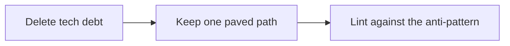

# Poteto's AI SWE Workshop — Key Insights

Source: Odysseas's notes from poteto's AI SWE workshop on X (Oct 2026). Parts marked *My reading* are the Software Architect's interpretation, to check against the source.

## Contents

1. [The AI Michelin kitchen](#1-the-ai-michelin-kitchen)
2. [Trust in agents](#2-trust-in-agents)
3. [An agent-friendly codebase](#3-an-agent-friendly-codebase)
4. [Gardener agents](#4-gardener-agents)
5. [The Dune framework](#5-the-dune-framework)
6. [Questions for our codebase setup](#6-questions-for-our-codebase-setup)

## 1. The AI Michelin kitchen

Many agents, each suited to one task, orchestrated like a kitchen brigade. It only works when you can trust each agent.

## 2. Trust in agents

| Source of trust | Meaning |
| --- | --- |
| Verification of their work | A **feature map** and a **CLI**. *My reading:* the map says which folder owns which feature, with its entry points and checks; the CLI is the set of commands an agent runs to check its own work (type check, lint, tests, evals, run the app) |
| High-quality skills | pstack was the example |
| An agent-friendly architecture | Greenfield (built for agents from day 1, like ours) vs brownfield (an existing codebase). To research |

## 3. An agent-friendly codebase

- **Pristine code.** LLMs extend the patterns already there, using the codebase as memory, so every pattern gets copied, good or bad. Hold a high quality bar.
- **Static analysis:** lint, compiler, CI. Agent reviews help, but aren't true static analysis.
- **Rules.** *My reading:* standing instructions agents load for every task, like our AGENTS.md and persona.md files (Cursor calls them rules; Claude Code uses CLAUDE.md and skills). Best scoped, so a folder's rules load only when working there, and kept short. Anything a machine can check moves into lint instead (Matt's rule 6).
- **Bugbot.** *My reading:* Cursor's AI reviewer, which comments on every pull request and follows repo-specific review rules. Our equivalent: Claude Code's `/code-review`, by hand or in CI, with the standards given to the reviewer only (Matt's rule 5).
- **Style guide:** loosely defined, so pull requests stay readable and reviews friendly for humans.

## 4. Gardener agents

Agents that tend the codebase, in this order:

The lint rule stops the problem from coming back. It matches Matt's retro step and rule 6.

## 5. The Dune framework

Five parts; Odysseas's guess is that it's harness-related.

| Part | Meaning (notes) | *My reading* for our app |
| --- | --- | --- |
| Feature | One folder per product UI feature | `features/weight-room/`, `features/meal-log/` |
| Entrypoint | One view a user can open (a route) | A screen, i.e. an Expo Router route |
| Transcript card | A feature-owned body for one entry point (unclear in the notes) | Content a feature renders inside a shared surface, e.g. an advice bubble on the homepage or a card in the dietitian chat |
| Client | State behind hooks and commands, with one writer | A store per feature: screens read it through hooks and change it only through commands |
| Host | Always-on behaviour behind a typed contract | Backend functions and schedules (weekly analysis, reminders) behind typed APIs |

Example vertical slice in a React app:

| Layer | Path |
| --- | --- |
| Feature UI | `features/<name>/workspace/entrypoint.ts` |
| Client | `client/<name>-store.ts` |
| Shared edge | `shared/<name>-rpc.ts` |
| Host extension | `extensions/<name>/extension.ts` |

Each feature lives in known places with typed edges, so agents can work on different features in parallel without touching the same files. We take the ideas, not the exact layout.

## 6. Questions for our codebase setup

- Which top-level folders, and what each one holds.
- How one feature maps to files: screen, store, contract, backend function, tests.
- The feature map: where it lives and how it stays current.
- The CLI agents run to verify their work: type check, lint, tests, evals.
- Where rules live: AGENTS.md, folder-level rules, skills.
- How review runs: `/code-review` by hand or in CI.
