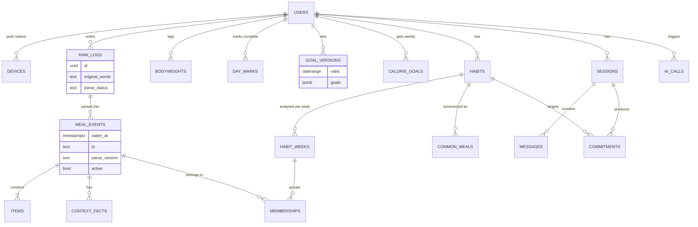
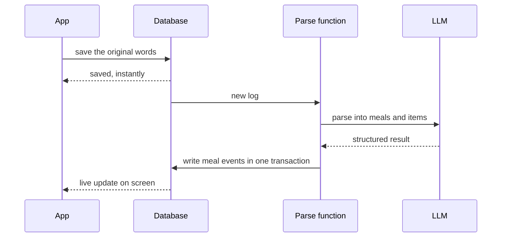

# Database Analysis — Relational vs Document

**27 Oct 2026.** How the app's main functions run on a relational database (Postgres, on Supabase) and on a document database (Firestore, on Firebase), what four reviewers found for and against each, and a proposal. Written by the Software Architect. Four subagents reviewed the first draft, an advocate and a critic per design, checking facts against official docs.

**In short:** go relational, on Supabase. The riskiest data here is written by an LLM and by AI coding agents. Only a relational database checks every write, links habits to meals with real foreign keys, and keeps this hardest-to-reverse choice reversible. Firebase's real advantages (instant saves on bad signal, built-in retries, longer function limits) can be added to Supabase with small, known pieces. Firestore's missing checks can only be replaced by discipline. Both designs reach planetary scale; the relational one gets there by sharding on user ID, which works because every query in the app is about one user ([§7](#7-at-planetary-scale)).

## Contents

1. [The question](#1-the-question)
2. [The two designs](#2-the-two-designs)
3. [How each function runs](#3-how-each-function-runs)
4. [What the reviewers found](#4-what-the-reviewers-found)
5. [Head to head](#5-head-to-head)
6. [Proposal](#6-proposal)
7. [At planetary scale](#7-at-planetary-scale)
8. [Sources](#8-sources)

## 1. The question

The client is locked (React Native + Expo) and the LLM layer agreed ([plan §9.4](product-plan.md#94-stack)). The backend is open, and its database is the hardest choice here to reverse.

- **Relational:** tables with typed columns, linked by keys and queried with SQL. The database enforces rules: types, uniqueness, links.
- **Document:** JSON-like documents in nested collections, read by path or by simple queries. There are no joins, so data read together is stored together.

Platform and data model are separate choices: Firebase can also host Postgres (SQL Connect, billed as Cloud SQL after a 3-month trial). This analysis compares the two data models in their usual homes, Postgres on Supabase and Firestore on Firebase.

## 2. The two designs

Both designs are the best version of each after the review (what changed: [§4.3](#43-corrections-to-the-first-map)). Both follow the plan's data rules ([§9.2](product-plan.md#92-data-rules)), and both share two more:

- **Scoring lives in one shared TypeScript package**, used by the functions, the app and the evals: logical day and week, totals, averages, completeness, trends, diet share, overlap, usefulness ([§9.1](product-plan.md#91-the-ai-extracts-code-scores)). The database stores sources and AI outputs.
- **Clients write only raw inputs:** original words, weights, settings, day-complete marks. AI outputs are written by server functions.

### 2.1 Relational (Postgres on Supabase)

- **Constraints check every write, the server's included:** types, one weight per user and day, foreign keys, an exclusion constraint against overlapping goal versions, and JSON-schema checks (`pg_jsonschema`) on the `jsonb` columns that hold LLM output.
- **Row-level security (RLS) on every table:** an event trigger switches it on for new tables, and views run with `security_invoker`.
- **Multi-table writes** go through one RPC function (plpgsql) per kind of write, each a single transaction: supabase-js can't span several tables in one.
- **Parse pipeline:** each raw log has a parse status. The parse function replies at once and works in the background; a cron sweeper or Supabase Queues retries logs left pending.
- **Parse versions side by side** with an active flag: comparing prompts or models on real history is a query, and rolling back is an update.
- **Schema in the repo** as SQL migrations, with TypeScript types generated from them; a local stack, pgTAP tests and advisors run from the CLI.

### 2.2 Document (Firestore on Firebase)

| Path | Holds |
| --- | --- |
| `users/{uid}` | Profile, settings, logging mode, boundaries, push tokens, next reminder time |
| `users/{uid}/rawLogs/{id}` | Original words, input type, logged at, parse status and version. The phone makes the ID, so a retry can't duplicate it |
| `users/{uid}/mealEvents/{rawLogId}_{n}` | Eaten at + timezone, approximate flag, part of day, size, parse version; items and context embedded |
| `users/{uid}/bodyweights/{yyyy-mm-dd}` | Weight, edited at. One per day by ID |
| `users/{uid}/dayMarks/{yyyy-mm-dd}` | Day-complete mark |
| `users/{uid}/goalVersions/{weekStart}`, `.../calorieGoals/{weekStart}` | One version per week by ID, create-only |
| `users/{uid}/habits/{habitId}` | Habit identity: its trigger |
| `users/{uid}/analyses/{weekStart}_{run}` | One immutable document per weekly analysis: habit groups with their `eventIds`, common meals, rewards, model and prompt version |
| `users/{uid}/commonMeals/{id}` | Template items, average nutrition, SVG picture |
| `users/{uid}/sessions/{id}` and `.../messages/{id}` | Session transcript |
| `users/{uid}/commitments/{id}` | If-then plan, habit ID, type, status |
| `users/{uid}/aiCalls/{id}` | Every LLM call, for evals |

- **No copied aggregates:** at our scale a year of weights is about 365 reads (the free quota is 50,000 a day), so the shared code computes totals and averages on read. A day is a range query on `eatenAt`. At planetary scale, per-read pricing brings copies back ([§7](#7-at-planetary-scale)).
- **Deterministic IDs** enforce rules: the phone makes raw-log IDs, events are `{rawLogId}_{n}`, versions are keyed by week start, weights by day.
- **Links are stored once,** in the weekly analysis document.
- **A zod data layer** (`withConverter`) defines every shape: server writes skip security rules, and nothing else checks them.
- **The native SDK** (React Native Firebase, in an Expo dev build) shows writes at once and queues them on bad signal.

## 3. How each function runs

The main flow has the same shape in both designs:

| # | Function | Relational | Document |
| --- | --- | --- | --- |
| F1 | Log a meal, parsed in the background ([plan §3.2](product-plan.md#32-meals)) | The app inserts a `raw_logs` row with a phone-made ID; a small outbox retries on bad signal. A webhook starts the parse function, which replies at once, calls the LLM and writes events and items through one RPC transaction. A sweeper retries logs still pending; Realtime updates the screen | The app writes a `rawLogs` doc; the native SDK shows it at once and queues it on bad signal. A function fires on create (retries on, idempotent by ID), calls the LLM and writes events with deterministic IDs. A listener updates the screen |
| F2 | Day page ([§3.3](product-plan.md#33-days)) | One query by `eaten_at` range (the shared code turns the logical day into a UTC range), items nested in the same select | One range query on `eatenAt`; items come embedded |
| F3 | Log or edit bodyweight: one a day, editable until the next day, huge jumps refused ([§3.1](product-plan.md#31-bodyweight)) | A unique (user, day) constraint; a function checks the jump and the edit window | The doc ID gives one per day; a function checks the jump and the window (rules can't compute local days) |
| F4 | Weight Room: week bars, completeness, full calendar ([§8.3](product-plan.md#83-weight-room)) | Read the weights for the range (about 365 rows a year); the shared code builds weeks, averages, completeness and trends | Read the range (about 365 docs a year); the same shared code |
| F5 | Weekly habit analysis ([§2.3](product-plan.md#23-weekly-habit-view)) | A scheduled job per user and week loads events and habits; the LLM groups and matches by trigger; one RPC writes `habit_weeks` and `memberships`. Foreign keys reject links to missing events | A scheduled function per user and week reads events and habits; the LLM groups and matches; it writes one immutable `analyses` doc with `eventIds`. Nothing checks the IDs exist |
| F6 | Trends and the goal lens ([§2.4](product-plan.md#24-habit-trends)) | Join `habit_weeks` across weeks; the goal version valid in each week comes from its date range, and the exclusion constraint prevents overlaps | Read one `analyses` doc per week and the goal versions; week keys prevent overlaps |
| F7 | Usefulness and diet adherence ([§4.3](product-plan.md#43-usefulness)) | The shared code, over loaded rows | The shared code, over loaded docs |
| F8 | Weekly calorie goal update ([§4.2](product-plan.md#42-measuring-progress)) | Load the complete days' events and weights; the shared code fits the trend; insert a `calorie_goals` row | The same loads and code; write `calorieGoals/{weekStart}` |
| F9 | Reminders ([§3.5](product-plan.md#35-reminders)) | `pg_cron` every few minutes finds users whose stored next reminder time is due and who haven't logged today, sends push through Expo's service and stores the next time | A scheduled function does the same; push through FCM or Expo |
| F10 | Sessions and commitments ([§6.2](product-plan.md#62-weekly-session)) | `messages` rows per session; commitments reference the habit; adherence is a query on next week's memberships | A `messages` subcollection; commitments store the habit ID; adherence reads next week's `analyses` doc |
| F11 | One-tap common meal ([§9.3](product-plan.md#93-ai-engineering-habits)) | Copy the common meal's items into a new event; nothing re-estimated | The same, embedding the template's items |
| F12 | Re-estimate history after a model or prompt change ([§9.2](product-plan.md#92-data-rules)) | A local script re-parses old-version raw logs, inserts the new events side by side and switches the active flag; F5 re-runs for the affected weeks. Stale links fail loudly | A local script re-parses and rewrites events; F5 re-runs. Old analyses keep stale `eventIds` silently unless checked |
| F13 | Change a representation rule, e.g. the 04:00 boundary ([§3.3](product-plan.md#33-days)) | Change the shared code; only date-keyed rows (weights, day marks) may need a small backfill | The same |
| F14 | Evals and the AI call log | Eval sets are SQL joins of original words, parse output and corrections | `aiCalls` exported by a script |
| F15 | Delete an account (an App Store requirement) | Delete the user: everything cascades if every foreign key says `on delete cascade`; stored files go first | One `recursiveDelete` of `users/{uid}`; stored files separately |
| F16 | Analytics across users, later | Plain SQL | Scripts or BigQuery |

## 4. What the reviewers found

Weights are for a solo, pre-MVP builder, after cross-checking the four reports against each other.

### 4.1 Relational

| Strength | Functions | Weight |
| --- | --- | --- |
| Constraints and foreign keys check every writer, including functions that write LLM output: the server role skips RLS, but not constraints | F1, F5, F12 | High |
| Habit–meal links live in one join table: overlap is a self-join, and stale links fail loudly | F5, F6, F10, F12 | High |
| The schema is a contract agents can check locally: migrations, generated types, pgTAP tests, advisors, an official MCP server | All | High |
| SQL is a bench for exploring logs and building eval sets before features exist | F14, F16 | Medium |
| Overlapping goal versions are impossible; parse versions can sit side by side | F6, F8, F12 | Medium |
| RLS can fence the app's AI: a function can query as the calling user, so a prompt-injected tool call can't read other users' rows | F10, history recall | Medium, from the second user on |
| The free plan includes functions with no card; data leaves with `pg_dump` or self-hosting | All | Low to medium |

| Weakness | Functions | Weight | Fix |
| --- | --- | --- | --- |
| The webhook behind background jobs (`pg_net`) is fire-and-forget: a 2 s default timeout and no retries, so a log can stay unparsed silently | F1, F5, F9 | High | Parse status, an immediate reply with background work, and a sweeper or Queues |
| Security is per object and fails open: new tables lack RLS unless enabled; views skip it unless `security_invoker`; 2026 platform changes outdate the examples agents learned from | All | High | An event trigger enabling RLS, `security_invoker` views, Security Advisor in CI, tests that a second user sees nothing and anonymous calls fail |
| supabase-js can't write several tables in one transaction | F1, F5, F12 | Medium | One RPC function per kind of write |
| No write queue on the phone: a log on bad signal can be lost | F1, F3 | Medium | A small outbox with phone-made IDs, so retries can't duplicate |
| The free tier pauses after a week idle, keeps no backups and caps the database at 500 MB | All | Medium | A nightly dump from a GitHub Action; Pro ($25/month) once others rely on the app |
| Scores computed in SQL views would split logic between SQL and TypeScript, and dependent views make migrations rigid | F2, F4, F8 | Medium | Scoring in the shared TypeScript package; SQL keeps storage, constraints and security |
| Edge Functions stop at 150 s on the free plan, 400 s on paid ones | F5, F12 | Low | One user-week per call; bulk re-parses and evals as local scripts |

### 4.2 Document

| Strength | Functions | Weight |
| --- | --- | --- |
| Instant saves that survive bad signal, and live screens, with no extra code. Needs the native SDK in a dev build; Expo Go queues in memory only | F1, F2, F3, F11 | High |
| At this scale copies are unnecessary: deriving on read in code removes drift and most backfills (not at planetary scale, [§7](#7-at-planetary-scale)) | F2, F4, F8, F12, F13 | High now |
| The LLM's parse output is the document: one zod schema is the output schema, the TypeScript type and the stored shape | F1, F11, F12 | High (design reasoning) |
| One immutable analysis document per week: one atomic write, easy diffs for stability evals | F5, F6, F14 | High (design reasoning) |
| Cloud Functions run longer (9 min triggers, 1 h HTTPS, 30 min task queues) and can retry | F1, F5, F12 | Medium |
| Natural-key IDs enforce rules: one weight a day, one goal version a week | F3, F6, F8 | Medium |
| Every server query starts at `users/{uid}`, so users can't mix by accident; rules are unit-tested in the emulator | All | Medium |
| FCM push and schedules in the same platform | F5, F9 | Low |

| Weakness | Functions | Weight | Fix |
| --- | --- | --- | --- |
| Server writes skip security rules and there's no schema, so agents drift on names, units and types | F1, F5, F8, F12, F14 | High | A zod data layer with `withConverter`; a nightly validation script |
| Links and versions have no integrity checks: a re-parse can leave dangling event IDs that trends and adherence read silently | F5, F6, F10, F12 | Medium | Links stored once; deterministic event IDs; create-only versions keyed by week |
| Copied aggregates drift, since triggers run at least once and out of order | F1, F3, F4, F8, F9 | High, but avoidable | Derive on read: no copies |
| Missing composite indexes pass in the emulator and fail in production; standard queries are limited | F2 and later queries | Medium | `firestore.indexes.json` in the repo; smoke tests on a real project |
| Coarse rules let a client overwrite its own AI outputs (the first relational draft had the same gap) | All | Medium | Clients write only raw inputs; field-level rules; rules tests |
| Functions need the Blaze plan with a card, and Firestore spend can't be capped | All | Low | Budget alerts; guards against trigger loops |
| Getting data out is custom work: subcollections need a recursive delete, and leaving means re-modelling | F15, F16 | Low now, rising | `aiCalls` under the user; one tested `recursiveDelete`; Firestore behind a data layer |

### 4.3 Corrections to the first map

- **Copied aggregates** in the document design were optional; both designs now derive on read in shared code.
- **Re-parsing changes event identity** in both designs, so habit links must be rebuilt by re-running F5. Relational fails loudly through foreign keys; Firestore fails silently.
- **Rule changes (F13)** are near parity once both derive on read: only date-keyed records may need a small backfill.
- **The relational webhook** has no retries: the sweeper or a queue is now part of the design.
- **Views skip RLS** unless `security_invoker` is set.
- **Reminders (F9)** need a stored next-reminder time and push tokens in both designs.
- **Account deletion (F15)** cascades only if every foreign key says so; Firestore's `aiCalls` moved inside the user's tree.
- **Firebase Extensions** shut down on 31 Mar 2027, so neither design uses them.

## 5. Head to head

| Criterion | Relational (Supabase) | Document (Firebase) | Edge |
| --- | --- | --- | --- |
| Integrity of AI-written data | Constraints and foreign keys check every write | Code only | Relational |
| Habit links, versions, history | Join table, exclusion constraint, versions side by side | One doc per analysis, keyed versions, no checks | Relational |
| Derived values | Shared TypeScript; SQL available too | Shared TypeScript; few query features | Relational, slightly |
| Instant save on bad signal | Needs a small outbox | Built in | Document |
| Background reliability | Needs a sweeper or Queues | Built-in retries; writes must be idempotent | Document, slightly |
| Long LLM jobs | 150 s / 400 s; bulk work as scripts | 9 min / 1 h / task queues | Document |
| Security setup | RLS per table, fails open; guardrails and tests | One rule per subtree; field-level care | Even |
| Agents verifying their work | Migrations, generated types, pgTAP, advisors, MCP | zod layer; emulator ignores composite indexes | Relational |
| Exploring data, building evals | SQL | Scripts or BigQuery | Relational |
| Cost now | $0, functions included, no card; pauses when idle | About $0 with a card; spend can't be capped | Relational, slightly |
| Growing to planetary scale | In steps, sharded by user; keeps integrity, cost control and vendor choice | Automatic, no ops work; per-operation cost, copies return, one vendor | Even, different costs ([§7](#7-at-planetary-scale)) |
| Leaving later | `pg_dump`, self-hosting | Re-model and rewrite | Relational |
| Learning value | SQL: core and transferable | NoSQL modelling: useful, narrower | Relational |

## 6. Proposal

**Go relational: Postgres on Supabase.** Five reasons decide it:

1. The riskiest writes come from the LLM and from coding agents, and only Postgres checks every write, the server's included.
2. The core analysis, habits ↔ meals and versions over weeks, is relational by nature, and its mistakes should fail loudly, not silently.
3. Agents can verify their own work against a typed schema, local tests and advisors: poteto's trust through verification.
4. The database is the hardest choice to reverse, and Postgres keeps it reversible.
5. The same model reaches planetary scale by sharding on user ID, while keeping its checks and cost control ([§7](#7-at-planetary-scale)).

Firebase's advantages are real but small to rebuild: an outbox for bad signal, a sweeper or queue for retries, local scripts for long jobs.

**Guardrails from day 1,** as the first ticket of MVP-slice-1:

1. Scoring in one shared TypeScript package; the database stores sources and AI outputs.
2. Clients write only raw inputs; AI outputs go through server functions.
3. RLS on by default (event trigger), `security_invoker` views, Security Advisor in CI, and tests that a second user sees nothing and anonymous calls fail.
4. One RPC function per multi-table write.
5. A parse status on every raw log, a parse function that replies at once, and a sweeper or queue for retries.
6. Phone-made IDs and a small outbox, so a log sent on bad signal is retried, never lost or duplicated.
7. Parse versions side by side with an active flag; JSON-schema checks on the LLM-output columns.
8. A nightly database dump; the Pro plan once others rely on the app.
9. Bulk re-parses and evals as local scripts.
10. Shard-ready from the start: `user_id` on every table, child tables included, and first in every index.
11. IDs are UUIDv7 (time-ordered), made by the app or the server; no global auto-increment counters.
12. No query in the app reads across users. Shared reference data, like a future food database, gets copied; analytics go to a warehouse.

**If you prefer Firebase anyway:** use the [§2.2](#22-document-firestore-on-firebase) design, plus composite indexes in the repo with smoke tests on a real project, budget alerts and one tested recursive delete. It works; it asks for more discipline in exchange for the mobile conveniences.

**What would change my mind:**

- Offline logging becomes a hard requirement, beyond retries.
- The first slice shows RLS and RPC friction slowing you down badly.
- Firestore's Enterprise pipelines (grouped queries, joins) become stable in React Native Firebase.

## 7. At planetary scale

Hard-to-reverse choices should hold if the app ever reaches hundreds of millions of users. A rough load: 100 million users logging 5 meals a day is 500 million logs a day, about 6,000 writes a second on average and several times that at mealtimes.

One property decides most of it: **every query in the app's daily flows is about one user.** Nothing reads across users, except analytics, which can run elsewhere. Data that splits cleanly by user can be spread over many machines, each holding whole users. That's sharding.

| | Relational | Document |
| --- | --- | --- |
| How it grows | In steps: a bigger Postgres, then read replicas, then big tables partitioned by time, then sharding by `user_id` (Citus, or a Postgres-compatible distributed database such as CockroachDB, YugabyteDB or Aurora Limitless). Same tables and queries throughout, if the schema is shard-ready | Automatically: Google spreads documents across servers, with no ops work. Keys must avoid hotspots, following Firestore's ramp-up and sequential-key guidance |
| Cost | Paid per machine; cheaper per operation at volume | Paid per read and write. Deriving on read gets expensive, so copied aggregates, and their drift, come back |
| Integrity | Constraints and foreign keys still hold, since each user's rows live on one shard | Still code only, now with copies to keep in sync |
| Analytics | Streamed to a warehouse such as BigQuery | Streamed to BigQuery |
| Leaving | Postgres-compatible options at every step | One vendor; at that size, leaving is a rewrite |

**Verdict:** both reach planetary scale. The document model gets there with no ops work, but its per-operation cost rises, the copies return and the lock-in is total. The relational model needs deliberate scaling steps, but keeps its integrity, its cost control and the choice of vendor. The proposal stands, with three shard-ready rules from day 1 ([§6](#6-proposal), guardrails 10–12).

## 8. Sources

Checked by the reviewers against official docs on 27 Oct 2026, except the scale section's two links, added by the architect.

- Supabase: [pg_net](https://supabase.com/docs/guides/database/extensions/pg_net) · [RLS](https://supabase.com/docs/guides/database/postgres/row-level-security) · [2026 change: tables not exposed automatically](https://supabase.com/changelog/45329-breaking-change-tables-not-exposed-to-data-and-graphql-api-automatically) · [function limits](https://supabase.com/docs/guides/functions/limits) · [function auth](https://supabase.com/docs/guides/functions/auth) · [Queues](https://supabase.com/docs/guides/queues) · [Cron](https://supabase.com/docs/guides/cron) · [pricing](https://supabase.com/pricing) · [project pausing](https://supabase.com/docs/guides/platform/free-project-pausing) · [generated types](https://supabase.com/docs/guides/api/rest/generating-types) · [testing](https://supabase.com/docs/guides/local-development/testing/overview) · [advisors](https://supabase.com/docs/guides/database/database-advisors) · [MCP](https://supabase.com/docs/guides/getting-started/mcp) · [pg_jsonschema](https://supabase.com/docs/guides/database/extensions/pg_jsonschema)
- Postgres and PostgREST: [range types and exclusion constraints](https://www.postgresql.org/docs/current/rangetypes.html) · [PostgREST transactions](https://docs.postgrest.org/en/stable/references/transactions.html)
- Firebase: [server libraries bypass rules](https://firebase.google.com/docs/firestore/security/get-started) · [function retries](https://firebase.google.com/docs/functions/retries) · [triggers run at least once](https://docs.cloud.google.com/firestore/docs/extend-with-functions-2nd-gen) · [offline data](https://firebase.google.com/docs/firestore/manage-data/enable-offline) · [aggregation queries](https://firebase.google.com/docs/firestore/query-data/aggregation-queries) · [pricing](https://firebase.google.com/pricing) · [function options](https://firebase.google.com/docs/reference/functions/2nd-gen/node/firebase-functions.globaloptions) · [task queues](https://firebase.google.com/docs/functions/task-functions) · [emulator and indexes](https://firebase.google.com/docs/emulator-suite/connect_firestore) · [deleting data](https://firebase.google.com/docs/firestore/manage-data/delete-data) · [avoiding surprise bills](https://firebase.google.com/docs/projects/billing/avoid-surprise-bills) · [Extensions shutdown](https://firebase.google.com/docs/extensions/faq-and-troubleshooting) · [Enterprise pipelines](https://docs.cloud.google.com/firestore/docs/release-notes) · [SQL Connect](https://firebase.blog/posts/2026/04/whats-new-sql-connect)
- React Native and Expo: [React Native Firebase](https://rnfirebase.io/firestore/usage) · [pipelines in beta](https://rnfirebase.io/firestore/pipelines) · [JS SDK persistence issue](https://github.com/firebase/firebase-js-sdk/issues/7947) · [Expo and Firebase](https://docs.expo.dev/guides/using-firebase/)
- Apple: [account deletion requirement](https://developer.apple.com/support/offering-account-deletion-in-your-app/)
- Scale: [Citus multi-tenant sharding](https://docs.citusdata.com/en/stable/use_cases/multi_tenant.html) · [Firestore best practices: hotspots and ramp-up](https://firebase.google.com/docs/firestore/best-practices)
