# Paper Notes: Diet App Product Thinking (6–15 Oct 2026)

A faithful transcription of ~31 handwritten A4 pages, in their original order. Page 0 is the part of the README that was filled in before the paper process began.
This file records how the ideas evolved, so it does not reorganize or deduplicate them. Later pages sometimes revise earlier ones, and both versions are kept.
Sketches whose layout carries meaning are redrawn as SVGs in [initial-notes-diagrams/](initial-notes-diagrams/), close to the paper originals in [initial-notes-paper-photos/](initial-notes-paper-photos/). Simple chains stay in Mermaid.

## How to read this file

| Mark | Meaning |
| --- | --- |
| ~~text~~ | Crossed out on paper but still legible. Scribbled-out false starts that can't be read are omitted. |
| `[Drawing: …]` | Description of a sketch or icon that is not a diagram. |
| > **Margin / box** | Text written in a margin or inside a box, set apart from the main flow. |
| **bold** | Underlined or wavy-underlined on paper. |
| `[?]` | Uncertain reading. All of these are listed in [Transcription notes](#transcription-notes). |
| ⚠ / (!) | Warning signs drawn on paper. |
| (+) | Your own marker for "to add / to research". |

Words squeezed in above or below a line (afterthoughts added where there was no room) are merged inline where they belong.

Abbreviations used on paper: **OB** = onboarding · **bw / b/w** = bodyweight · **Str/Hyp** = strength / hypertrophy · **Com.Risk** = communication risk · **d.d.p.** = diet defining percentage · **hp** = high-protein · **Gl.M.DB** = global meal DB.

## Contents

| Date (top right) | Pages | Topics |
| --- | --- | --- |
| before paper | [0](#page-0--readme-before-the-paper-process) | README: summary, problem, goals |
| 6.10 | [1](#page-1--610) | Diet App: core idea, outcomes, team |
| 7.10 | [2](#page-2--710) · [3](#page-3) · [4](#page-4) · [5](#page-5) | Habit loop, rewards, main user flows, AI main flows |
| 8.10 | [6](#page-6--810) · [7](#page-7) | Rewrite #1 of the product plan, triggers, aspects of a meal |
| 9.10 | [8](#page-8--910) · [9](#page-9) · [10](#page-10) | Data modeling, user's meals database, meal event fields |
| 10.10 | [10 (second sheet)](#page-10-second-sheet-marked-10--1010) · [11](#page-11) · [12](#page-12) | Personal dietitian session, user phases, dietitian comments |
| 12.10 | [13](#page-13--1210) · [14](#page-14) · [15](#page-15) · [16](#page-16) · [17](#page-17) · [18](#page-18) · [19](#page-19) | Supermarket / food supply, onboarding, Build Muscle and Lose Fat OB paths |
| 13.10 | [20](#page-20--1310) · [21](#page-21) · [22](#page-22) · [23](#page-23) · [24](#page-24) · [25](#page-25) | Measuring progress, habit history, habit trends, user's goals, usefulness |
| 14.10 | [26](#page-26--1410) · [27](#page-27) · [28](#page-28) | Biggest selling point, diet rules and macros |
| 15.10 | [29](#page-29--1510) · [30](#page-30) · [31](#page-31) | Design / wireframes: homepage elements |

Pages without a date continue the session of the last dated page before them.

---

## Page 0 — README (before the paper process)

*Only the parts you wrote are included here. The untouched template sections (§2 Prompt Engineering to §11 Appendix, plus the empty Input/Output, Constraints, Success Metrics and Checklist prompts in §1) are left out.*

**Ai Powered Eating Habits.** An AI Software Engineering Project: to help you transform your eating habits and reach your ideal bodyweight.

**0. Project Summary**

- **Problem:** Personalized eating habits guidance.
- **Why it matters:** A low-cost approach to a healthy, effective diet.
- **Approach:** Log your morning bodyweight and tell the bot what you just ate.
- **Success metric:** Progress toward your target bodyweight.
- **Key risk:** Users may not consistently log meals or engage with the bot.

**1. Business / User Problem**

Most people want to lose fat, build muscle or just eat healthier.
Instead of following strict diets, or logging in detail what they eat to the last calorie, the simplest, lowest friction way to move towards these goals is to modify already existing habits.
The user just logs their morning bodyweight and what they ate just their voice, or camera.
Then the app has enough information to track their habits and suggest healthier and cheaper alternatives.
(+) After the MVP liquid intake and hydration will also be taken into account.

(+) Why is AI engineering the right approach (vs. traditional software, rule-based systems, or classical ML)?

**Goal**

The user reached their ideal bodyweight.
The suggestions helped them overcome a bad habit.
Their eating habits require less money, less time, make them less hungry.
Their new habits support their exercise needs, helping them have the proper energy and recovery from their workouts.
Longshot, but maybe their new habits will help them overcome an eating disorder.

The onboarding period is 1 week.
In that time, the user logs their food and we create a clear picture of their current habits.
After 1 month, the free trial ends and we have been able to provide tangible visible results.

**Stakeholders**

Solo Career Mode Activated.
Maybe a dietitian or a behavioural psychologist would be helpful, but for now we have LLMs.
As the project grows, the team grows.

**Prior Work:** Researching … … …

---

## Page 1 — 6.10

### 1. Diet App

- Most people want to lose fat, build muscle or just eat healthier. Instead of following strict diets, or logging in detail what they eat, the simplest, lowest friction way to move towards these goals is to modify already existing habits. The user just logs their morning bodyweight and what they just ate through voice or camera, and the app has enough info to track their habits & suggest healthier or cheaper alternatives as the user moves closer to their goals. Also liquid intake & hydration should be taken into account.
  - (?) SWE, Rule-Based, ML approaches
- The user reached their ideal bodyweight. Their eating habits require less money, less time, make them less hungry throughout the day, provide them with more energy and less brain fog.
  `[A bracket with an arrow groups the next three lines]`
  - Their new habits helped them overcome an eating disorder ~~or just a bad habit~~.
  - They also support their exercise needs.
  - The suggestions helped them overcome a bad habit.
- A dietitian or a behavioural psychologist would be helpful ~~for~~ my team.
- Researching other such apps…
- I/O

---

## Page 2 — 7.10

### Habit Loop

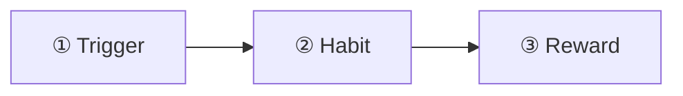

**① Triggers:**
- On my way to work
- When I am alone at night ↳ loneliness
- Before Working Out

**Types of Triggers:** Time Based / Situation Based / Environment Based / Emotionally Based

**② Habit: Eating a meal** — (!) brain fog danger

- **Size of meal:** snack < normal < laaarge
  - snack ↓ (careful about multiple stacking snacks)
  - tiny: ⚠
  - XL: ⚠ till stomach can't take any more
- **Price ($) of meal**
- **Calories & Macros** can be inferred by the AI to a good enough degree to provide guidance
  - Protein / Fat → high sustenance
  - Fat → greater than 0 for hormonal health
  - Carbs → Energy for Athletic Activities
  - Calories → Scale Outcomes
- (?) **Brand:** Keto or Fads, like food that starts with the letter L (Loser).

---

## Page 3

**③ Reward:**

| Type (margin label) | Reward |
| --- | --- |
| (pain) | No hunger *(Even though, through **Fasting**, Hunger is a friend)* |
| (pleasure) | Pleasure of eating |
| (pleasure) | Pleasure of the environment / socializing |
| (pain) | Psychological coping mechanism to cover an emotion |
| (gamification here) ← | Reaching your goals: • bodyweight • eating habits • hydration goal |

---

## Page 4

### Main User Flows *(boxed title)*

(Bodyweight loaded through Input field or Chat)

**User Voice:**

| Descriptiveness | Example |
| --- | --- |
| ↑ less descriptive | "I ate X" |
| ↓ more descriptive | "bla bla bla, …, bla bla bla" |

(More info for the AI, possible cost for the user, especially if he is in front of people)

`[Three lines marked "//" in the left margin]`
- No voice options ⚠ ~~especially after~~
- ~~After habit~~ After initial habit understanding
- → offer no-voice options

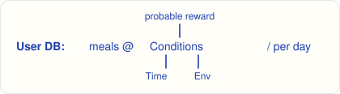

In a week, we can have a good idea of core habits; in a month an even clearer picture. But in a month we should demonstrate results → **1-month free trial**.

---

## Page 5

### AI Main Flows

- **Log a meal** / Or a whole day roughly, at the end of a day
  - ↳ Ask for additional information *(Com.Risk!)*
  - ↳ Propose assumptions for deletion *(Com.Risk!)*
    - ↳ Give ability for user to not use the feature. Or even give direct orders
- **Analyze Eating Log** for weekly habits
  - Locked in first week's Onboarding
    (Pay for unlock? First Year / 6 months cheaper? ⤳ First Payment discounted!)
- **Offer Recommendations**
  - Biggest battle: Supermarket Habits (defined in Onboarding)
  - Suggest (if appropriate) high modifiability meals like
    - Yogurt ($ income source)
    - Or pasta, cheaper alternative

> **Box (bottom right):** + App Complaint Service, Chat-like with Requests

---

## Page 6 — 8.10

> **Box (top right, the whole box crossed out):** ~~+ meal modifiability & supermarket budget~~

### Rewrite #1 of product plan *(boxed)*

Business proposition remains the same.

**Core Idea: Habit Loop**

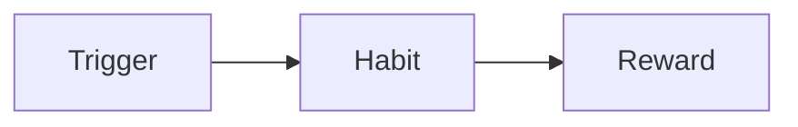

**Triggers** can be:
- ⊙ To eat healthy / for my goals
- Emotional (Hunger, Anxiety)
- Time Based
- Contextual (Environment, Company or anything else)
- or a mix

**Examples:**
- On my way to work
- When I am **alone** at night ↳ Loneliness
- Before working out
- In the morning
- When I'm with Mike
- On the office lounge

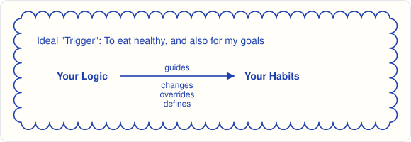

---

## Page 7

`[Horizontal line drawn at the top of the page]`

**Habit: Eating a meal**
- The way of eating can provide some additional information related to the habit, but of low importance. Examples: "rushed", "slowly", "with attention to the taste (mindfulness)".

**Main aspects of a Meal:**
- **id:** for global meal DB reference
  - (+) Research for its structure, possible meal families
- **name:** User given (might inform Gl.M.DB)
- **size:**
  - snack: small plate or smaller

*(Rest of the page blank.)*

---

## Page 8 — 9.10

### Data / Modeling *(boxed title)*

- **Habit:**
  - **Time of day** (Main Trigger). Important for daily habits as they are the base of most diets and also define **Hunger**. Hunger is also a habit, as it comes at times you are used to eating.
  - **Contextual Triggers [ ]** (Secondary Triggers). Like place, company, before / after / during an event, or whatever else the AI finds. Sometimes they define a habit more than the time_of_day.
  - **Common Meals [ ]**. Some people might eat the same exact meal each morning. Others might eat whatever is offered at the university campus that day. The AI should analyze the logged meals related to the main habit-defining trigger and summarize them ~~into 1-5 meals representing the habit~~ into 1–5 **common meals** representing the habit. Those meals should have the average nutritional value (calories & macros) according to user history and a **usefulness value** related to the user's goals.
  - **Rewards [ ]**. The main one should be the **usefulness value** related to the user's goals. Through analysis of the user's meal history, other rewards related to the habit should also be defined.

> **Margin box:** (+) For MVP, I need to define the **usefulness value** and **gamification** in general.

---

## Page 9

### User's Meals DataBase *(boxed title)*

~~Each Meal should have~~ *(crossed out)*

> **Box (top right) — Day's rough parts:** • Morning • Lunch Time • Afternoon • Night • Midnight

User's eating data should be organized in a daily fashion, so they can easily click a day and see their eating **events**. A user's day should be defined by their **sleep**, so something like 04:00–04:00 in the user's timezone should be good enough to give a clear picture. For users with unstable sleeping habits, contextual triggers like "when I wake up", "before work", "at lunchtime" should be enough to keep the app useful to them. Unstable sleep (+ stomach) should be defined in onboarding.

**Each Meal event should have:**
- **Time information.** Mainly the **part of the day** that the meal belongs to. ~~Timestamp of the logging event.~~ The relative logging event, which ideally should be right after eating, thus only the timestamp can be enough. A strict order of meals throughout the day should be easily inferred; the user should be able to change it in the "day page", with a confirmation prompt if the "save changes" button isn't clicked.
  - Workouts should also exist as a "day event".
- **Contextual information [ ].** All other kinds of relevant info to the meal event, each with a confidence factor like: directly logged by user ⟷ inferred through habit trend, maybe also other methods of inference.

*(continues ↓)*

---

## Page 10

⚠ hmm… sometimes meals have parts that would be better if logged separately… Maybe a meal event consists of 1 or multiple ~~"foods"~~ "items"?

- **Size of meal:**

  | Snack | < normal | < large | < XLarge |
  | --- | --- | --- | --- |
  | small plate or handful | large plate | heavy large plate, or a large w/ side | until stomach can't take any more |

  (!) multiple snacking should be logged separately *(line pointing to Snack)*
- **Price:** general estimate (if relevant to user)
- **Time:** Preparation time cost. Supermarket time not included. (if relevant to user)
- **Nutritional Value:** • Calories • Protein • Fat • Carbs
- **Goal Value:** Related to the user's goals at that time. The user should not be able to change goals for the **trial month** (without buying), and the goals should be changeable for free only once per week, since recalculating all the previous weeks' goal values is costly. And only this last week's goal values should be changeable. **Scarcity → Commitment.**

(+) ⚠ Trade-offs for using images as the primary logging option, for greater UX: Low contextual info. Higher storage cost (if we store them). Logging cost?

---

## Page 10 (second sheet marked 10) — 10.10

### Personal Dietitian Session for recommendations

- AI should have expert Sales, Dietitian & Behavioural Psychology knowledge to handle the conversation properly.
- Unlocked after 1st OB week.

**1st subject of discussion:** Supermarket / Food Supply habits. Highest impact decisions.

**2nd: Tactical advice.**
Identify the most **detrimental** (high potential value) habits with ~~the highest room for~~ the **[lowest cost changes]** *(boxed)*.
- Like keeping the timing but substituting the meal for a healthier alternative.
- Keep the meal substitutions similar in taste palette.
- If a user likes variety, offer them options of affiliate places to find them (maybe after MVP we add a simple user recipe book).
- Use meals with high modifiability. Either for users who want to have a more step-by-step approach, or for their easy variation benefits.

- Try to use **objection prevention** before the recommendation offering.
- Keep messages short.
- Always ask for compliance before moving on, keeping the possibility open for the user to raise issues / object.

*(continues ↓)*

---

## Page 11

- Handle objections before moving on.
- Remind them when necessary of their ideal outcome and the changes required for that. As well as ~~tiy~~ tying them to their deeper goals if reasonable.
  - In OB find deeper goals like: lose fat → for upcoming wedding. Build muscle → to be more attractive. ↳ to unlock higher athletic potential.
- The outcome of the conversation should be 1–5 habit changes that the user can commit to for the following week. And ask for explicit commitment. If the user is unsure, be OK with him only committing to what he has high certainty of.
  - Continue trying until we have commitment on at least one change for the following week.
- Summarize the commitments for the following week and post them on top of the homepage.
- These "Dietitian Recommendation Sessions" should be available only 1/week. For scarcity & realistic cooperation.
- Ask the user before starting to be in a comfortable place with enough time for an important conversation.

**The User should be in 1 of three phases:**

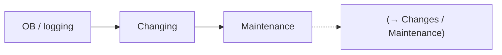

---

## Page 12

- Each time the user logs a meal, their personal dietitian should comment:
  - **Onboarding phase:** Thank them for logging. Encourage the logging behaviour with no judgment, with a random message. (After MVP, maybe add character to the dietitian, user-defined.)
  - **Changing phase:**
    - Congratulate them when they apply the changes.
    - Be kind when they fall short. Make them understand that you noticed. And provide them a guilt-free way to log the reason of the mishappening. Even provide possible solutions for next time the challenge arises, if appropriate.
  - **Maintenance phase:** Probably as OB, as no new changes should be established. (Maintenance phase requires more research.)

- A cart icon in the homepage for the Supermarket / Supply Page.
- Hmm… Each meal / food item should also have supply information, as well as whether the user has full control over it or other people are involved in that.

---

## Page 13 — 12.10

### Supermarket / Food Supply

**Homepage icon:** 

- Should be mostly a read-only page with the user's food supply habits established in onboarding. Also noting if other people play a significant role in defining them (most of the time providing time or cost $ benefits).
- Should be updated only through a dietitian session.
- Should also have a to-do list of all the changes the user agreed with the dietitian for the future, like:
  - Next time you go to the supermarket, don't buy sweets; buy fruits that you can eat freely when you feel cravings.
    - [ ] Next time in supermarket buy fruits instead of sweets
  - If the university lounge doesn't have high-protein meals:
    - [ ] Have your homemade protein shake with you in university as a high-protein meal alternative
- Is it legally OK to advise things like:
  - Have a conversation with your significant other, sharing your goals and asking them if they can help?

  These kinds of things should probably be handled in the dietitian session with tact and strict guardrails.

---

## Page 14

- This food supply to-do list with the next steps should be on top of the habits in the supply page.
  - Each item should be marked as completed after a confirmation prompt.
  - Widgets for each item should also exist in the home screen. Read-only.

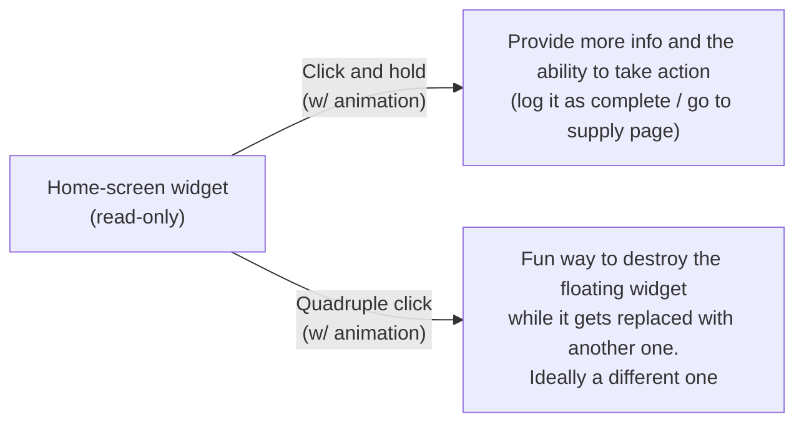

---

## Page 15

### Onboarding *(boxed title)*

- Basic user stats (gathered at the end of the onboarding for better UX)
  - age
  - gender {male, female, other / don't want to specify}
  - height
  - bodyweight (initial estimate) ("if you don't have a scale at hand, provide a rough initial estimate")

- **Start of Onboarding:**

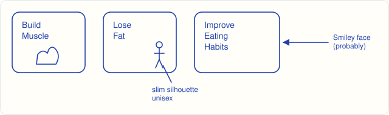

- After the initial user-input onboarding, they will enter the app (with a brief overview, beyond MVP) and the only thing available will be their initial dietitian_OB_session. ~~Clarifying their goals,~~
  - Clarifying their goals
  - Defining their current problems (sales)
  - Setting their expectations (initial logging & a preview of how they will continue to work)
  - Committing to the next steps (daily bw measurement + log food logging)

---

## Page 16

**Build Muscle OB path:**

- **AI:** A proper diet can help, but a proper strength or hypertrophy training program is also necessary. Even if you only do 2 full-body sessions per week.
  - (Key word **proper**. We cannot oversee their training, but 2 expertly made ones are enough for **beginners** (assumption).)
  - (We need to be careful about the claims we make. Maybe we should have a DB with double-checked ones, so the AI can use them easily and with low cost.)
  - We probably shouldn't make any assumptions.
- We should be able to get a good idea of the users' minimum physical-activity sessions, and whether they are Strength/Hypertrophy (thus muscle-building focused) or other (still good for their health).
- The Dietitian AI should be able to propose starting a physical activity habit. ~~By joining~~ By the user joining a local gym / dance studio / martial arts class / hiking community, or even ~~lowest priority option for most able to~~ a long walk habit (great psychological benefits, not so much on the physical and mental side compared to other options).
  - The benefits of physical activity in the life of a human are greater than any medical pill.
  - A physical job should also be taken into account, as it covers the basic physical activity requirements.

---

## Page 17

### … Build Muscle OB Path *(+ small smiley doodle)*

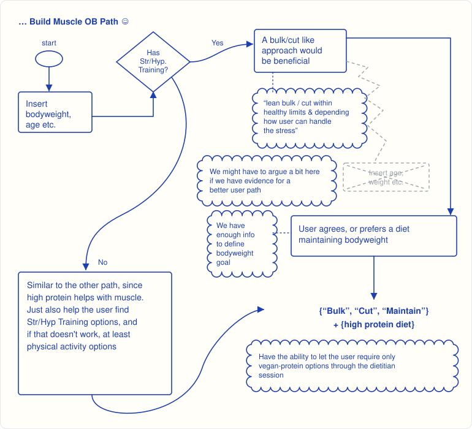

*Scalloped shapes are the cloud notes from the sketch. The gray dashed box is the one you crossed out and replaced with the arrow to "User agrees".*

---

## Page 18

- Even though a physical activity habit is always recommended, the user has the final say and can continue without it. He can even explicitly ask the AI dietitian to never ask again, adding it to the AI's **"limiting beliefs"**: a curated list of such explicit rules, accessed in the settings page. This one also hides the workout-related features (since the user doesn't have, and explicitly doesn't want to create, such a habit). Of course we inform him that he can undo that in settings → limiting_dietitian_beliefs.
- The App should have an exercise page , similar to the supply page and with similar functionality, as the user's health and scale outcomes depend heavily on physical activity.
- At the start of the onboarding we should ask the user if he has a scale easily accessible when they wake up. The user should be able to continue using the app even without the scale feature, another "limiting dietitian belief". But of course we should argue against it first, as it is our main way of measuring progress.
  - The ideal bodyweight measurement is in the morning, after a full night's sleep and a possible trip to the toilet. Fluctuations are to be expected and should not discourage the user.

…

---

## Page 19

…

- Beyond MVP, we could also track women's menstrual cycle.
- Beyond MVP, track how much the user's stomach is "filled", to predict hunger and give advice after a heavy meal, or encouragement dealing with hunger, if appropriate.

**Lose Fat OB Path:**
- Similar to the "Build Muscle", but with only acceptable outcomes:
  - "cut"
  - "maintain" w/ Str/Hyp. Training
  - else insist on a realistic outcome that is not "lose fat"
- The AI should always recommend cheap options that also accommodate the user's goals.
- Seems like we also need a **goals page**.

> **Box (right):** (+) Workout related rules section, with a second small "(+)" box under it, arrow ↓ pointing to "goals page"

---

## Page 20 — 13.10

### Measuring Progress

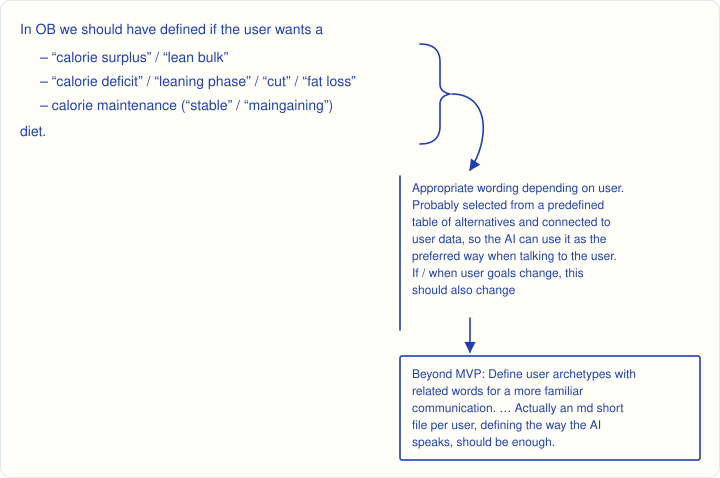

We measure that mainly through ~~bodyweight~~ our hard bodyweight measurements.
We also have a general idea of what calories the user consumes daily, so we have a good idea of their daily expenditure.
So we have:
- **hard** b/w measurement
- **soft** calorie intake measurement

**Main diets we offer:**
- low carbs (fat loss)
- high protein
- Beyond MVP: Keto

---

## Page 21

- We should also have a **habit history page** with a weekly view (as the smallest time window we measure).
  Each habit, besides the **usefulness score** towards the user's goals, should have a
  **(d.d.p.) diet defining percentage:** how much of the user's diet is defined / covered by that habit. We can mainly measure that by the **calorie intake that they define**.

**User's Meal Map** (for habit concept demonstration purposes) **Example: "Table 1"**

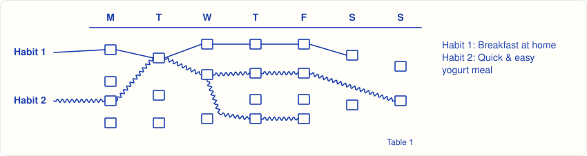

Each small square is one meal, earlier at the top. Squares without a line belong to neither habit.

- Each week, through analysis, we should be able to define 3–5 major habits. Some meals' calories might be double-counted; it's OK, but we should keep **habit overlap** to a minimum.
  - We measure habit overlap again through calories. Example (from Table 1):
    - Habit 1 overlaps 20% to Habit 2
    - Habit 2 overlaps 15% to Habit 1

    As we see, the overlapping relationship is not symmetric.
- For d.d.p.: Even if we have 5 non-overlapping habits completely "defining" the diet, a 20% d.d.p. is already a major score. A user-friendly presentation might be:
  **20%** —(×100 above the arrow, ×5 below)→ **100** (– important)

---

## Page 22

### Habit Trends *(Goal dependent analysis)*

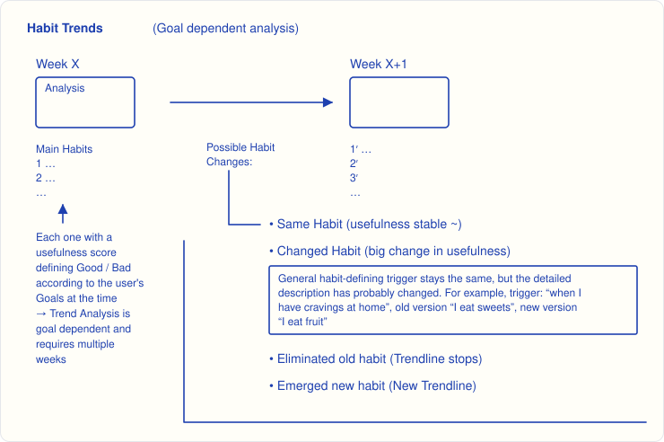

- We should be able to analyze Habit Trends from back when the user had different goals (goals can change 1/week max). But make it visually explicit which older data are goal-mismatched. Maybe with a gray-scale or shadow overlay, with a clear visual of goal-changing "moments" and the ability to see these older goals in detail with a click; maybe even change the "lens" of the ~~analysis~~ trend analysis with them. (Costly compute & storage)

---

## Page 23

- Let's keep the workout-related stuff beyond MVP.

### User's Goals

1. **Bodyweight**

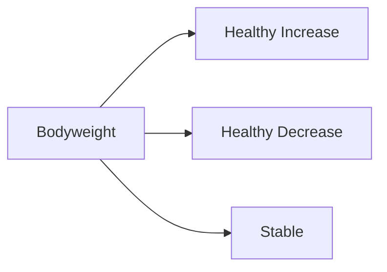

2. **Diet Adherence.** The user follows a specific diet. In the MVP we offer a low-carb diet, best for fat loss, and a high-protein one, aiming for a (peer-reviewed) protein daily intake, for muscle growth.
3. **Custom User Goals.** Let's start with one user-defined goal. Basically some short text that the user is able to define freely, and the AI can run over meals or habits to define their usefulness compared to a baseline. The initial baseline is the first week's logging.
   That Custom User goal might be a specific user-defined diet.
   It is important that the user-defined text defines a singular goal and that it is not a security risk for the app.

- These goals should have a strict priority order, agreed and confirmed by the user. By default it's like the above, 1 > 2 > 3, but it can be changed, probably through a nice drag and drop. *(a scribbled-out note at the right edge, possibly "Default: …")*

---

## Page 24

### Usefulness

- Through Goal prioritization we can define weights for each goal's importance. We should use a logarithmic scale for these, like

  $$w_{G1} = 2\,w_{G2} = 4\,w_{G3} \dots, \qquad \sum w = 1 \qquad (\alpha = 2)$$

  so we can sum the "usefulness" from each goal.

**For Bodyweight**
- Through prior logging we have:
  - A daily avg cal. intake
  - Average daily meals
  - ~~A bodyweight trend. (Rough avg of the start vs at [?])~~
  - ~~If bodyweight trend is stable (as it is for most people who are not actively involved in their diet / OB logging)~~
  - ~~With the bodyweight goal which defines a~~
- At the OB week we consider a stable bodyweight (and we inform the user we don't want a change of habits, also for this reason, so we get a good view of his current state).
- With the user's b/w goals and the above, we can define a daily calorie goal.
- We should **NOT** define an avg meal calorie goal which will define the meal's usefulness.
- ~~So actually the usefulness~~
  Each meal can have a diet adherence metric and maaaybe a custom-user-goal metric.

---

## Page 25

- Actually each meal can have a "bodyweight usefulness" if we take into account the current daily calories the user has consumed. But that will complicate things, so let's keep it out (Beyond MVP).
- In a daily or weekly view we can measure how well the user is doing at his goals.
- From a habit POV we can make a judgement call on whether it is contributing to undereating or overeating.

**For Diet Adherence**
- Should be an easy "if the rules of the diet apply" for
  - a meal
  - a day / week
  - a habit

**For Custom Goals**
- Big unknown (probably the whole concept will go beyond MVP).
- For ~~diet defining~~ ~~custom rules~~ custom goals / rules that are like defining a diet, it will be easy.
- For ones like meal money cost, it might be manageable; we will just need a rough evaluation of the cost of the meal. (And some guardrails, like never suggest a user to abuse his relationship with another human for free food.)

**… So for the MVP, the usefulness will be ~~rough calorie esti[mate]~~ about calories and diet adherence.**

---

## Page 26 — 14.10

### Biggest Selling Point

- Actually, trying to sell ideas through an AI agent is a very hard multidisciplinary problem. Even though I'm interested and still believe it's a great business opportunity (14.10.2026).
  The low-hanging fruit, the easiest way to make the user change his **habits**, is to give him **a clear view of them**. And yesterday I think I built the mechanism for that.
  It also makes sense to "business pivot" into a generic habit visualization tool. But this is not the business of my dreams; it's a way to practice AI SWE.

---

## Page 27

**Diet Rules, that I forgot to add earlier, and that probably require direct references to studies if they [?] and further research for completeness**

- Maybe also a lib page.

**Macro Facts**
- Carbs can help anabolism
  - Insulin helps anabolic pathways
  - Glycogen-filled muscles help protein synthesis
- Carbs play a huge role in daily energy levels
  - (↳ + muscle building requires training
  - ↳ + high-quality training requires high energy expenditure
  - ↳ So for muscle building we want a "high-protein diet" with enough carbs. → **"hp"** diet)

**Macros for "hp" diet**

| Macro | Amount |
| --- | --- |
| Protein | 1.8 g/kg/day *(?)* (82 kg → 150 g) |
| Fats | 0.65 g/kg/day |
| Carbs | ≥ 100 g `[?]` |

> **Box (right):** Let's start the app in the metric system, but beyond MVP it should support American madness as well.

**Progress for "hp" diet**
- +0.25–0.5 % bw / week
- Rule of thumb: +275 cals → +0.25 kg / week

**Progress for "low carb" diet**
- We want to slowly decrease the daily carbs while the user can sustain the lower daily "energy" and the cravings. If he gets over the initial hurdle (~1 week), his body will reach a new equilibrium. And if he sustains that for long (~1 m), he will be able to easily go back to it, even if he relapses.

---

## Page 28

**Continuing…**
- We can give him a daily carb allowance tool to help him with that.

**Extra**
- Snack multiplier: 1 – 2 – 3 – too many
- User's common meals page inside meal logger
  - informed weekly & w/ history feature

---

## Page 29 — 15.10

### Design / Wireframes *(boxed title)*

(Mobile First) (UX takes priority)

**Homepage elements:**
- **Settings Gear** (User administrative info & the rest)
- **Advice** (Maybe Outline Color defines Category / Source)
  - Animated, floating, clickable
    - Click and hold → more info
    - Click + 3 clicks → destruction, new advice

    > **Margin box (arrow → the two click actions):** Make the user complete these actions once when they first sign up.
  - **Category / Sources:**
    - **Library** (General knowledge / rules of thumb + Habit related knowledge)
    - **Scale:** Reminder ("log your weight for the day! :D")
      - └ Possible weight-goal related message (keeping vibes positive) ~~except if the user is …~~
      - (Maybe the dietitian can present some harsher facts once in a while if necessary.)

      > **Side note (arrow → ":D"):** female-friendly smiley face
    - **Dietitian**
      - Diet Adherence Related Advice
      - Useful personalized reminders found through sessions
    - **Log today's meals reminder**
      - like "don't forget to log your meals today! :D"
    - **Supermarket related personalized advice**
      - 1 general advice: "Best way to control a problem is through its source" ~Bboy Heavy Metal 15.10.2026
        or "Best **place** to control a problem is **at** its source" ~Bboy Heavy Metal 15.10.2026

*(Continuing next page)*

---

## Page 30

- **Exercise Advice** (Beyond MVP)
- **Menstrual cycle advice** (if user identifies as female)
  - Beyond MVP, except 1 general advice: ~~The Menstrual~~ "Your menstrual cycle can significantly affect bodyweight, feel free to use the scale regardless" (or a shorter version of the idea)

- **Dietitian Room** (elements)
  - With a locked new-session button, possibly with an animated weekly unlock bar, like:

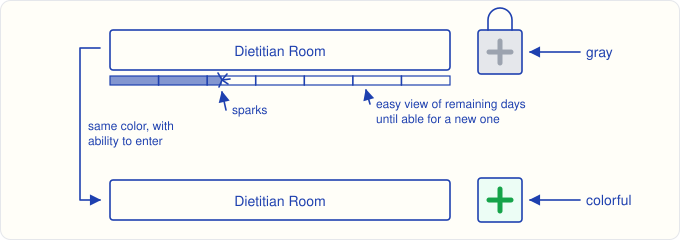

- **Library Entry Point**
  - Small button with a book / bookshelf icon, like: . Maybe each color defines a category section inside the library, like:
    - General Dietary Knowledge
    - Habit Loop Knowledge
    - Major Diets (& related knowledge)

    (Library should be small, important and memorable.)

*(Continued…)*

---

## Page 31

- **Bodyweight Room Entry Point / Scale**
  - A small button with a scale
  - Two states (user has logged his weight at least once today, or he hasn't)
- **Meal Log Entry Point**
  - Meal Trends inside this page
  - Maybe a big button beneath the Dietitian
- (**Exercise Advice Entry Point:** Beyond MVP. **As well as hydration**, maybe a few more)
- **Supermarket Advice Entry Point**
  - Small button, cart, 1 state

*(Rest of the page blank.)*

---

## Transcription notes

**Page numbering.** All 32 photos are in order. Two different sheets are both marked **-10-**: the "Meal event" continuation (9.10) and the "Personal Dietitian Session" page (10.10). Both keep the number 10 here. The second one is labelled "second sheet marked 10".

**Uncertain readings `[?]`:**
- p.2: "food that starts with the letter **L (Loser)**". Read this way because the 7 Oct product plan uses the same "L for loser" example.
- p.24: the crossed-out line "Rough avg of the start vs at…" is only partly legible.
- p.27 header: there seems to be a missing word after "references to studies if they …".
- p.27: the carbs value is written like "7,100g". It is read here as **≥ 100 g**.
- p.29: the end of the crossed-out line "except if the user is …" can't be read.
- p.21: the Meal Map is a best-effort redraw of where the two lines run. Habit 2's wavy line seems to branch from Wednesday down to the late Thursday and Friday meals.

**Other marks not transcribed:** small ✓ ticks at the top-left of pp. 26, 27 and 29 (and possibly 25), and small doodles and ink dots that don't carry meaning.

**Spelling fixes:** obvious misspellings were corrected silently, e.g. phycologist → psychologist, helpfull → helpful, lonelyness → loneliness, infered → inferred, weat → week, Adhearance → Adherence, Custome → Custom, Scarecity → Scarcity, expedeture → expenditure, accomondate → accommodate, benefitial → beneficial, flating → floating, personilized → personalized, hyration → hydration, Complain Service → Complaint Service. "Dietician" and "dietitian" are both written as **dietitian**. Words that are wordplay or deliberate were kept: "laaarge", "maaaybe", "maingaining", "mishappening", "American madness".
