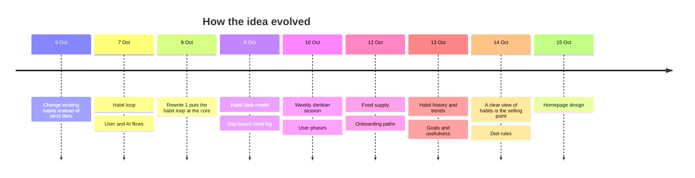
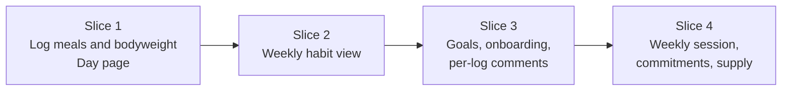

# Product Plan — Council Review

**21 Oct 2026.** Review of [product-plan.md](product-plan.md) v2.
**Speaking:** Software Architect (mentor). **Consulted:** Dietitian Expert, Designer, Sales Expert.
Proposals only. Confirm the I-calls and accept or reject the other IDs (e.g. "P1 yes, N7 no"). Accepted ones move into the plan, then this file is deleted.

## Contents

1. [How I read the notes](#1-how-i-read-the-notes)
2. [Top proposals](#2-top-proposals)
3. [Data foundations](#3-data-foundations)
4. [Behaviour and nutrition](#4-behaviour-and-nutrition)
5. [UX](#5-ux)
6. [Research you missed](#6-research-you-missed)
7. [Decisions for you](#7-decisions-for-you)
8. [Next steps](#8-next-steps)

## 1. How I read the notes

Calls I made where the notes conflict or stay vague:

| ID | Call | Based on |
| --- | --- | --- |
| I1 | The core value is a clear view of habits; the dietitian session is the second layer | p26, your latest strategic note |
| I2 | The product moved from a "mobile-first chatbot" (7 Oct plan) to an app with rooms; chat lives in sessions and logging | p29–31 |
| I3 | A habit = time-of-day main trigger + contextual triggers; emotions became contextual triggers | p8 supersedes the trigger types of p2 and p6 |
| I4 | Advice bubbles absorbed the supply-page widgets; to-dos are one bubble source | p29 generalizes p14 |
| I5 | Weekly commitments stay at the top of the homepage | p11; p29's homepage list omits them |
| I6 | Workout features are later, but onboarding still asks about training | p23 vs p17: the bodyweight goal depends on it |
| I7 | Sizes: Snack < Normal < Large < XL ("tiny" dropped); the snack multiplier counts portions inside one snack event | p10, p28 |
| I8 | When basic stats are asked is left open | p15 (at the end) vs p17 (first) |
| I9 | Trial, paywall, affiliates and legal are parked; the old legal checklist stays in git | Your request |

## 2. Top proposals

### P1. Build the core first, in thin slices, and use it yourself for 2 weeks

The notes' MVP is about ten features. The riskiest assumptions are that people log daily (the README's key risk) and that the AI can turn rough logs into habits that reveal something new. Testing them needs no onboarding, sessions, bubbles, supply page or library.

- Voice for free in slice 1: the phone keyboard's dictation into a text field.
- Single user: no accounts, no payments.
- Done when you log at least 12 of 14 days and the second week's habit view shows you something you didn't know.

### P2. The AI extracts, code scores

| Job | Done by |
| --- | --- |
| Turn a log (text, transcript, photo) into meal events and items with nutrition estimates | LLM |
| Group a week's events into 3–5 habits and match them to last week's | LLM |
| Comment on logs; run onboarding and weekly sessions | LLM |
| Days, parts of day, units, unlocks, reminders | Code |
| Expenditure, calorie goal, bodyweight trend | Code |
| Diet-adherence rules, usefulness, d.d.p., overlap, trends | Code |

- Extraction doesn't depend on goals; scoring does. So a goal change or an older-goal lens re-runs arithmetic, not the LLM, and the cost reasons behind the weekly goal lock (p10) and the costly lenses (p22) disappear. Keep the lock only if you want it for behaviour. The custom goal is the exception: judging free text needs the LLM.
- Scores become explainable and unit-testable.
- This table is also your answer to the README's "why AI engineering?" question.

### P3. A habit's identity is its trigger

Your "changed habit" (same trigger, sweets → fruit) implies that trends match habits across weeks by trigger. Give habits stable IDs keyed by their trigger; the weekly analysis maps its groups onto existing IDs before creating new ones. Without this there are no trends. It also makes commitments checkable ([N6](#4-behaviour-and-nutrition)).

### P4. Stable calorie estimates beat accurate ones

Progress compares hard bodyweight with soft intake ([plan §4.2](product-plan.md#42-measuring-progress)). A bias that stays constant is largely absorbed: if every meal is estimated 20% high, so is expenditure, and the calorie goal is in the same units. d.d.p. and overlap are ratios, so a constant bias cancels in them entirely. What hurts is bias that changes over time: a new model or prompt, the same meal estimated differently from week to week, or missing logs (P5).

- Reuse the user's common-meal values for repeat meals instead of re-estimating.
- A model or prompt change shifts the bias: version AI outputs ([§3](#3-data-foundations)) and re-estimate history when it happens.
- Test estimate stability before accuracy. The global meal DB can wait.

### P5. Remind outside the app, at the user's own meal times

Bubbles only work while the app is open, and logging consistency is the key risk. Push notifications timed from the habit data (e.g. 30 minutes after a usual lunch) and a phone home-screen widget for one-tap logging are the cheapest retention levers. Add a "day complete" mark, so expenditure and habit analysis skip incomplete days instead of reading them as undereating.

## 3. Data foundations

Cheap now, painful to retrofit:

| Topic | Proposal | Why |
| --- | --- | --- |
| Raw input | Keep the user's original words (text or transcript); drop raw audio after transcription | Re-parse old logs with better prompts or models; less privacy risk |
| AI outputs | Tag each with its prompt and model version | Know what to recompute; compare versions |
| Time | Store when eaten as a UTC instant + IANA timezone, and when logged separately; derive the 04:00 day and part of day | End-of-day logging, travel, daylight saving |
| Rough time | Allow "part of day" without a time | End-of-day logs are rough |
| Goals | Version them with start dates; never overwrite | Goal-mismatched overlays and lenses need the history |
| Units | Store kg, g, kcal; convert at display | Imperial later costs nothing |
| Confidence | Keep stated, inferred, confirmed and rejected values apart | Your confidence factor (p9); deleting assumptions |
| Usefulness | Put every goal's usefulness on one scale (e.g. 0–100) before weighting | Otherwise the weights mean nothing. With factor 2, goal 1 always outweighs all lower goals combined: the strict priority you wanted |

AI engineering from day 1:

- Structured outputs (JSON schema) for parsing and habit analysis, validated before saving.
- Prompts in versioned files (README §2).
- An evaluation set from your own logs: expected items, size and part of day; your own habit grouping. Also check stability: the same week analysed twice should give the same habits.
- The custom goal (later) is user text inside a prompt. Treat it as data, never instructions: the security risk you sensed in p23 is prompt injection.
- The library is the AI's only source of health claims. Your "double-checked claims DB" (p16) and "lib page" (p27) are the same thing. It's small enough to sit in the prompt; no vector search at first.

## 4. Behaviour and nutrition

Already well supported, keep them: self-monitoring, your p26 pivot, is one of the best-evidenced techniques for weight change (Burke et al., J Am Diet Assoc 2011). Changing the food environment, your supply focus, beats relying on willpower (Wood, *Good Habits, Bad Habits*, 2019).

| ID | Notes say | Proposal | Start reading |
| --- | --- | --- | --- |
| N1 | Low carb is "best for fat loss" (p23) | Healthy low-carb and low-fat diets lost similar weight over a year; the deficit and adherence do the work. Offer low carb as a style some users prefer, and let the bodyweight goal carry fat loss | DIETFITS: Gardner et al., JAMA 2018 |
| N2 | hp macros (p27) | Protein 1.8 g/kg is inside the usual 1.6–2.2 range. Check fat against 20–35% of energy: 0.65 g/kg falls below 20% at high intakes. ≥ 100 g carbs is a floor, not a training target. The insulin → anabolism reason is weak once protein is adequate; fuelling training is the solid one | Morton et al., BJSM 2018; ISSN protein position stand, 2017 |
| N3 | +275 kcal ≈ +0.25 kg/week (p27) | Fine to start, but static rules drift. Let the observed bodyweight trend correct the calorie goal each week | Hall et al., Lancet 2011 |
| N4 | Fluctuations shouldn't discourage (p18) | Show a smoothed trend weight, not the raw number. A week of weights is too noisy for a trend, so the first expenditure estimate is the onboarding intake under your stable-weight assumption, refined over the next weeks | Walker, *The Hacker's Diet* |
| N5 | The onboarding week leaves habits unchanged (p24) | Logging alone changes behaviour (measurement reactivity). Good news for the core, but week 1 isn't a pure baseline | Search "self-monitoring reactivity" |
| N6 | Weekly commitments (p11) | Phrase each as an if-then plan on a habit's trigger: "When [trigger], I [new meal]". Strong evidence, and checkable from the logs via P3 | Gollwitzer & Sheeran, 2006 meta-analysis |
| N7 | Sales: objection handling, "compliance" (p10–11) | Use Motivational Interviewing as the backbone: users voice their own reasons and keep autonomy, matching "the user has the final say". NEPQ-style questions fit inside it. Say "agreement", not "compliance" | Miller & Rollnick, *Motivational Interviewing* |
| N8 | Visible results within a month (p0) | Habits take about two months on average to become automatic, with a wide range. Promise visibility and first changes in month 1, and time Maintenance later | Lally et al., Eur J Soc Psychol 2010 |
| N9 | Eating-disorder recovery as a longshot (p0) | Don't target it. Daily weighing and calorie focus can harm people with an eating-disorder history. Add a screening question and a stop-and-refer rule; no deficit for underweight users; adults only | — |
| N10 | Hydration is later (p0) | Log caloric drinks and alcohol as items from day 1; they're often whole habits (beer with friends). Water tracking stays later | — |

## 5. UX

- **U1. Visible fallbacks for gestures.** Hold and tap-4× are hidden, and a one-time tutorial gets forgotten. Keep the fun, but tapping a bubble should open a sheet with visible Done and Dismiss buttons. Respect the OS "reduce motion" setting. Prototype 2–3 homepage variants before deciding (Matt's prototype step).
- **U2. Assumptions as removable chips.** Show a parsed log as chips (items, size, part of day, context); inferred chips look different from stated ones; tap × to delete. That's your "propose assumptions for deletion" with zero questions, the lowest-ComRisk default. Ask only when a missing detail changes the score.
- **U3. Logging speed is the metric.** A repeat meal in about two taps (common meals), a new one in one spoken sentence. Save instantly and parse in the background, so a slow AI never blocks logging.
- **U4. Names users understand.** "Limiting dietitian beliefs" → "boundaries" (in psychology, limiting beliefs are beliefs that hold a person back). "d.d.p." → "diet share", shown as plain "% of this week's calories", with no ×5 unit to learn.

## 6. Research you missed

| Area | Question |
| --- | --- |
| Prior work | What do Noom (psychology coaching), MacroFactor (adaptive expenditure, trend weight), Ate (photo journal without calories), MyFitnessPal or Cronometer, and photo-AI calorie apps do well and badly? Use 2–3 for a week |
| Language | Greek, English or both? Speech-to-text and LLM quality in Greek; Greek dishes |
| First users | Who first? Decides the language, the diets and which onboarding path to build first |
| Cost | Cost per active user per day (about 5 parses and 5 comments, plus the weekly analysis and session), before choosing models |
| History recall | How the app's AI recalls a user's history in a session: your open homework (agentic retrieval vs vector RAG) |
| Eating out | Shared plates (meze), restaurant portions |
| Session design | COM-B and the Behaviour Change Technique Taxonomy (Michie et al. 2013), to design sessions systematically |
| Diet-rule granularity | How a daily rule (g/kg/day) judges a single meal or a habit |

## 7. Decisions for you

**Architecture.** Per my persona, you answer first: your pick and why. Then I give mine and we grill.

| Decision | Options | Trade-offs |
| --- | --- | --- |
| Client | Native iOS (SwiftUI) · cross-platform (React Native/Expo, Flutter) · PWA | Native: best feel, home-screen widgets, on-device speech; Android means a second codebase. Cross-platform: one codebase, near-native; widgets need native code. PWA: fastest iteration, no app store; no home-screen widgets, and iOS push only after "Add to Home Screen" |
| Backend | Backend-as-a-service (e.g. Supabase) · own API (e.g. FastAPI, as in the README template) | BaaS: auth, storage and database on day 1; vendor coupling. Own API: full control and Python AI tooling; more to build and host |
| Database | Relational (Postgres, SQLite) · document (e.g. Firestore) | Relational: joins across events, habits and goals; schema migrations. Document: flexible and quick to start; queries across entities are harder |
| LLM | One provider · a thin abstraction over several; a model per job (P2) | Simplicity vs swapping models per job on cost and quality |
| Offline | Offline-first (local store + sync) · online-only | Offline-first: logging never fails (metro, gym), but sync and conflicts to build. Online-only: simpler; a failed log is a lost log |

**Product** (my recommendation in brackets): how a habit's bodyweight effect is scored, open in [plan §10](product-plan.md#10-open-questions) [score bodyweight per day and week only for now; habits get d.d.p. and diet adherence].

## 8. Next steps

1. Confirm I1–I9 and accept or reject P1–P5, N1–N10, U1–U4.
2. Answer the architecture decisions in §7.
3. Run Matt's pipeline on slice 1: `grill with docs` → `to spec` → `to tickets` → `implement`. The grilling also starts the glossary, with the U4 renames.
4. Meanwhile, use 2–3 of the prior-work apps for a week.
