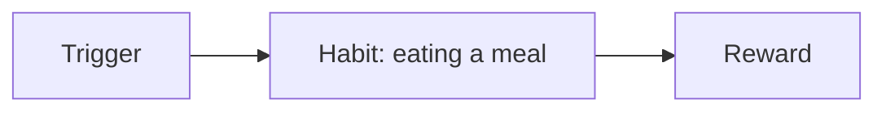
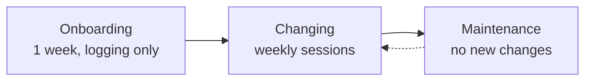
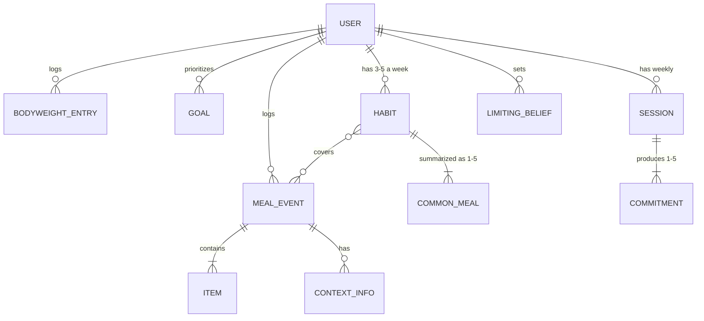
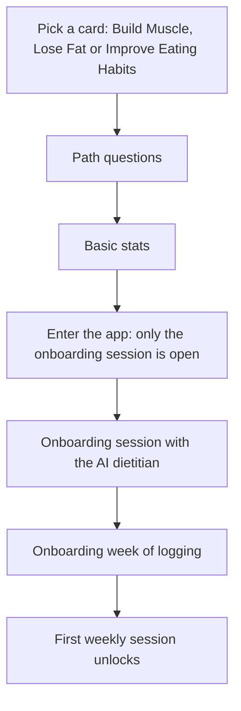
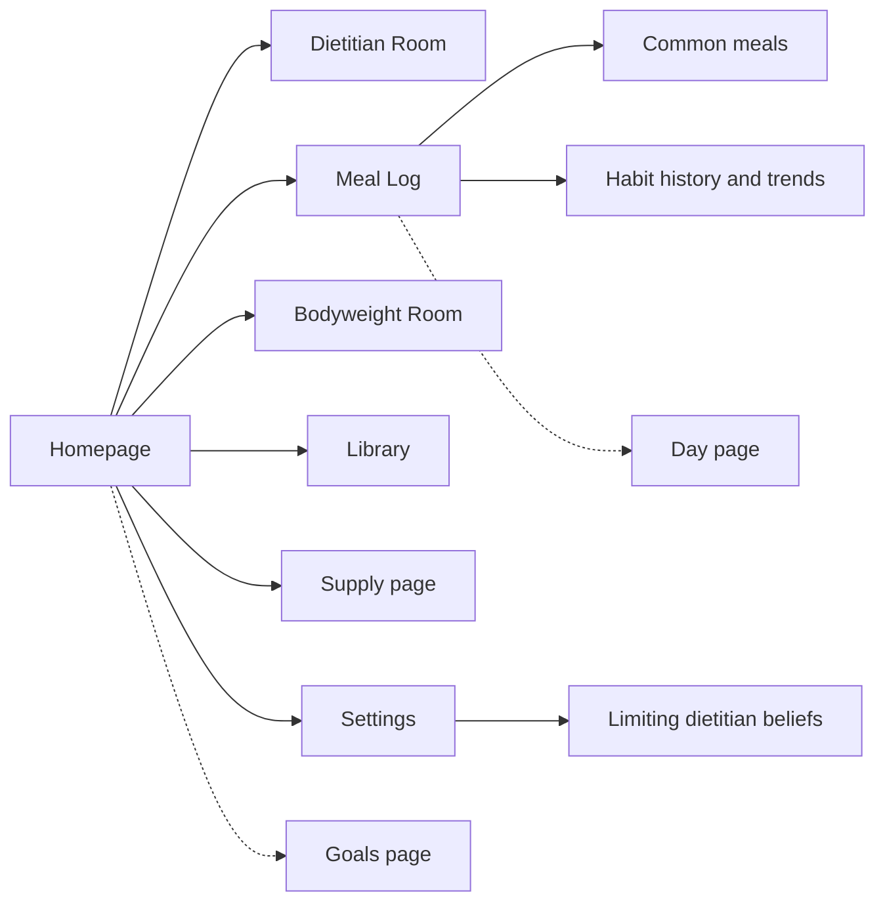

# AI-Powered Eating Habits — Product Plan

**Version 2, 21 Oct 2026.** Rewritten from the [paper notes](initial-notes/initial-notes.md) (6–15 Oct) and the 7 Oct plan. Where the notes changed their mind, the latest version wins; the notes keep the history. `p26` = page 26 of the notes.
Council proposals, research gaps and open decisions are in [product-plan-review.md](product-plan-review.md). None of them are applied here.

## Contents

1. [Vision](#1-vision)
2. [The habit model](#2-the-habit-model)
3. [Logging](#3-logging)
4. [Goals and progress](#4-goals-and-progress)
5. [Onboarding](#5-onboarding)
6. [The AI dietitian](#6-the-ai-dietitian)
7. [Food supply](#7-food-supply)
8. [Screens](#8-screens)
9. [Scope](#9-scope)
10. [Open questions](#10-open-questions)

## 1. Vision

- **Why this project:** practice AI software engineering on a real product. A generic habit-visualization tool would be a logical pivot, but this app is the vehicle (p26).
- **Problem:** most people want to lose fat, build muscle or eat healthier. Strict diets and calorie-exact logging are high friction; the lowest-friction path is to change the habits they already have.
- **Selling point:** a clear view of your own eating habits, the easiest way to make someone change them (p26). Persuading through an AI is the harder, second layer ([§6](#6-the-ai-dietitian)).
- **How it works:** users log their morning bodyweight and what they ate ([§3](#3-logging)). The app's AI turns each week of logs into habits scored against the user's goals ([§2](#2-the-habit-model), [§4](#4-goals-and-progress)). A weekly session with the AI dietitian turns that view into small changes toward healthier, cheaper alternatives ([§6](#6-the-ai-dietitian)).
- **Outcomes for users:** reach their goal bodyweight; overcome a bad habit; food that costs less money and time, with less hunger, more energy and less brain fog; habits that fuel their exercise and recovery. Longshot: help overcome an eating disorder.
- **Success metric:** progress toward the target bodyweight.
- **Key risk:** users stop logging or stop engaging with the AI.
- **Team:** solo. The council's personas stand in for a dietitian and a behavioural psychologist until the team grows.

## 2. The habit model

_Notes: p2–3, p6, p8, p11, p21–22._

### 2.1 Habit loop

The ideal trigger is "to eat healthy and for my goals": the user's logic guides (changes, overrides, defines) their habits.

### 2.2 A habit

| Part | Definition |
| --- | --- |
| Main trigger | Time of day. It is the base of most diets and defines hunger, which is itself a habit: it comes at the times you're used to eating |
| Contextual triggers | Place, company, before/during/after an event, emotion, or anything else the AI finds. Sometimes they define a habit more than the time does |
| Common meals | 1–5 meals the AI summarizes from those logged under the trigger, each with average calories and macros from the user's history and a usefulness score ([§4.3](#43-usefulness)) |
| Rewards | Main: usefulness toward the user's goals. Others found by analysis: no hunger (though through fasting, hunger can be a friend), pleasure of eating, pleasure of the setting or company, coping with an emotion |

Trigger examples: on my way to work · alone at night (loneliness) · before working out · in the morning · when I'm with Mike · at the office lounge.

### 2.3 Weekly habit view

Each week the AI defines the user's 3–5 major habits. A week is the smallest window. The first analysis comes at the end of the onboarding week; a month gives a clearer picture.

- **Usefulness score:** [§4.3](#43-usefulness).
- **Diet-defining percentage (d.d.p.):** the share of the week's calories a habit covers, kcal(habit) / kcal(week). Five non-overlapping habits covering the whole diet are 20% each, so 20% is already major. Shown ×5: 20% → 100, "important".
- **Habit overlap:** a meal can belong to two habits and be counted twice; keep overlap minimal. It's measured in calories and is asymmetric: overlap(A→B) = kcal(A ∩ B) / kcal(A).

In this example Habit 1 overlaps Habit 2 by 20%, and Habit 2 overlaps Habit 1 by 15%.

### 2.4 Habit trends

Comparing week X with week X+1, a habit is:

- **Same:** usefulness stable.
- **Changed:** same trigger, different meal, big usefulness change. "When I have cravings at home": sweets → fruit.
- **Eliminated:** its trendline stops.
- **Emerged:** a new trendline starts.

Trends are goal-dependent and need several weeks. Weeks analysed under older goals stay visible but marked as goal-mismatched (gray or shadow overlay), with goal-change moments shown and older goals viewable on click. Maybe also re-view trends through an older goal's lens (costly compute and storage).

### 2.5 User phases

Maintenance needs research. Candidate ideas from the 7 Oct plan: meal logging drops to weekly, bodyweight stays daily plus a weekly questionnaire, interaction frequency adapts to the user.

## 3. Logging

_Notes: p0, p4–5, p7, p9–10, p12, p18, p28._

### 3.1 Bodyweight

- Measured in the morning, after a full night's sleep and a possible toilet trip. Daily fluctuations are expected and must not discourage the user.
- Entered in the Bodyweight Room or through chat.
- A scale is optional ([§6.3](#63-limiting-dietitian-beliefs)).

### 3.2 Meals

- **Input:**
  - Voice: more description gives the AI more to work with, but costs effort and can be awkward in front of people. Once the AI understands the user's habits, offer no-voice options.
  - Text, through the input field or chat.
  - Photo: better UX, but little context, plus storage and processing cost (open, [§10](#10-open-questions)).
  - Common meals: quick logging from a page inside the meal logger, updated weekly, with history.
- **When:** ideally right after eating, so the log time is enough. Or roughly, for a whole day, at its end.
- **Clarifications:** the AI may ask for more information, or propose assumptions the user can delete. Both carry **communication risk (ComRisk)**: the chance that the AI's questions or assumptions burden users enough to disengage. Users can switch them off, or give the AI direct orders.

### 3.3 Days

- A day runs 04:00–04:00 in the user's timezone, defined by sleep. For unstable sleepers, contextual anchors ("when I wake up", "before work", "at lunchtime") keep the app useful. Onboarding asks about sleep stability (and stomach).
- Parts of the day: morning · lunchtime · afternoon · night · midnight.
- The **day page** shows the day's events in strict order. Users can reorder them; leaving without saving asks for confirmation.

### 3.4 Meal event

One eating occasion, made of one or more **items** (parts better logged separately).

| Field | Content |
| --- | --- |
| Time | Part of the day, plus the log timestamp |
| Name | User-given. May inform a future global meal DB |
| Size | Snack: small plate or handful < Normal: large plate < Large: heavy large plate, or large with a side < XL: until the stomach can't take more |
| Nutrition | Calories, protein, fat, carbs. AI estimates, good enough for guidance |
| Context | Place, company, emotion, way of eating (rushed, slow, mindful), each with a confidence: stated by the user ⟷ inferred from habit trends or otherwise |
| Supply | Where the food came from, and whether the user controls it or others are involved |
| Price, prep time | Rough estimates, only if relevant to the user. Prep time excludes shopping |
| Goal value | Diet adherence under the goals at that time ([§4.3](#43-usefulness)) |

Each snacking occasion is its own event, so stacked snacks stay visible. A snack multiplier (1 · 2 · 3 · too many) counts portions within one.

### 3.5 Data at a glance

A commitment is either a habit change or a supply to-do ([§7](#7-food-supply)).

## 4. Goals and progress

_Notes: p10, p19–20, p23–25, p27._

### 4.1 Goals

Goals have a strict priority order agreed with the user: by default 1 > 2 > 3, reordered by drag and drop.

1. **Bodyweight:** healthy increase, healthy decrease, or stable.
2. **Diet adherence:** follow a diet ([§4.4](#44-diet-rules)). MVP: low carb (for fat loss) and high protein (for muscle growth).
3. **Custom goal** (later): one free-text goal, e.g. a user-defined diet or meal cost. The AI judges meals and habits against a baseline, the first week's logs. It must state a single goal and must not be a security risk.

- Goals change at most once a week, and only the last week's goal values are recalculated: recalculating older weeks is costly, and scarcity builds commitment.
- The bodyweight direction gets the wording the user prefers, picked from a predefined table, stored with the user and used by the AI whenever it talks to them. It changes with the goal.

  | Direction | Wording options |
  | --- | --- |
  | Surplus | "calorie surplus", "lean bulk" |
  | Deficit | "calorie deficit", "leaning phase", "cut", "fat loss" |
  | Maintenance | "stable", "maingaining" |

- A **goals page** shows the goals and their order.

### 4.2 Measuring progress

- **Hard** measurement: bodyweight. **Soft** measurement: calorie intake from the logs. Together they give a good idea of daily expenditure.
- During the onboarding week bodyweight is assumed stable (users are asked not to change habits, partly for this), so average logged intake ≈ expenditure. The week also gives the average number of meals per day.
- Bodyweight goal + this baseline → a **daily calorie goal**. There is no per-meal calorie goal.

### 4.3 Usefulness

Each goal weighs twice the next: w₁ = 2·w₂ = 4·w₃ and Σw = 1, i.e. 4/7, 2/7, 1/7 (2/3, 1/3 with two goals). Usefulness is the weighted sum over goals. **In the MVP, usefulness covers calories and diet adherence.**

| Goal | Meal | Day / week | Habit |
| --- | --- | --- | --- |
| Bodyweight | Later: needs the day's running calories | Calories vs daily calorie goal | Does it push toward over- or undereating? |
| Diet adherence | Do the diet's rules hold? | Same | Same |
| Custom (later) | AI judgment vs baseline | Same | Same |

Custom goals are the big unknown. Diet-like ones are easy; cost-like ones need rough meal prices and guardrails (never suggest abusing a relationship for free food).

### 4.4 Diet rules

Every rule needs study references before use ([§6.4](#64-library)). Metric units first.

- **Why macros matter:** protein and fat give satiety; fat must stay above zero for hormonal health; carbs give daily energy and training fuel, and may help anabolism (insulin, full glycogen stores); calories drive bodyweight.
- **High protein ("hp"):** building muscle needs training, and quality training needs energy, so: high protein with enough carbs.

  | hp diet | Amount |
  | --- | --- |
  | Protein | 1.8 g/kg/day (?), e.g. 82 kg → ~150 g |
  | Fat | 0.65 g/kg/day |
  | Carbs | ≥ 100 g/day (uncertain reading) |
  | Progress | +0.25–0.5% bodyweight/week. Rule of thumb: +275 kcal/day ≈ +0.25 kg/week |

- **Low carb:** lower daily carbs gradually while the user can sustain the lower energy and the cravings. After the first hurdle (~1 week) the body finds a new equilibrium; sustained for ~1 month, it's easy to return to after a relapse. Tool: a daily carb allowance.

## 5. Onboarding

_Notes: p11, p15–19._

- **Asked along the way:** is a scale within reach on waking (asked first); sleep stability (and stomach); food supply habits and who else shapes them; deeper goals, e.g. lose fat → an upcoming wedding, build muscle → be more attractive or unlock athletic potential.
- **Basic stats:** age; gender (male, female, other / prefer not to say); height; bodyweight, a rough estimate if no scale is at hand. Gathered at the end for better UX (p15), though the Build Muscle sketch asks first (p17).
- **Onboarding session:** clarify goals; define current problems (a sales step); set expectations (initial logging, a preview of what follows); commit to next steps (daily bodyweight and meal logging).

### 5.1 Build Muscle path

- The AI explains that diet helps, but proper strength or hypertrophy training is necessary; for beginners, even 2 full-body sessions a week (assumption). Training can't be supervised, so claims stay careful and come only from double-checked ones ([§6.4](#64-library)).
- Learn the user's minimum weekly activity sessions, and whether they are strength/hypertrophy.
- Users can require vegan-only protein options through a dietitian session.

### 5.2 Lose Fat path

Like Build Muscle, but the only acceptable outcomes are "cut" or "maintain with strength/hypertrophy training". Otherwise the AI insists on a realistic outcome that isn't "lose fat".

### 5.3 Improve Eating Habits path

Not defined yet.

### 5.4 Physical activity

- Always recommended: its benefits beat any pill. The AI can propose joining a gym, dance studio, martial arts class or hiking community, or at least a long-walk habit (mainly psychological benefits). A physical job counts.
- The user has the final say and can opt out for good ([§6.3](#63-limiting-dietitian-beliefs)).

## 6. The AI dietitian

_Notes: p10–13, p16, p18, p27, p30._

The app's AI acting as the user's personal dietitian, with expert dietitian, behavioural-psychology and sales knowledge.

### 6.1 Comment on every log

| Phase | Comment |
| --- | --- |
| Onboarding | Thank them and encourage logging, with no judgment; a random message |
| Changing | Congratulate applied changes. When they fall short: be kind, show you noticed, offer a guilt-free way to log the reason and, if appropriate, solutions for next time |
| Maintenance | Probably like onboarding |

### 6.2 Weekly session

- One a week, for scarcity and realistic cooperation; the first comes after onboarding ([§5](#5-onboarding)).
- Before starting, the AI asks the user to be somewhere comfortable, with enough time for an important conversation.
- **Agenda:**
  1. Food supply habits: the highest-impact decisions ([§7](#7-food-supply)).
  2. Tactics: the most detrimental habits with the lowest-cost changes. Always prefer cheap options that fit the user's goals. Keep the timing and substitute the meal, within a similar taste palette. For variety, point to places to find alternatives. Use high-modifiability meals for step-by-step change or easy variation, e.g. a yogurt base (dessert-style with chocolate flakes, or with oats or fruit), or pasta as a cheap base.
- **Conversation rules:** prevent objections before recommending; keep messages short; ask for agreement before moving on, leaving room to object; handle objections; when useful, remind users of their ideal outcome and deeper goals.
- **Outcome:** 1–5 habit changes the user explicitly commits to for the next week. If unsure, they commit only to what they're certain of, but to at least one. The commitments are summarized at the top of the homepage.
- Advice involving other people (e.g. sharing your goals with your partner and asking for help) needs tact and strict guardrails.

### 6.3 Limiting dietitian beliefs

Explicit rules users set for the AI, like "never ask me about exercise again" or "I don't use a scale". Listed in settings and undoable there; users are told so. Some hide features (workouts). For important ones the AI argues before accepting, e.g. the scale, the main progress measure.

### 6.4 Library

Small, important, memorable. It holds the double-checked claims, with study references, that the AI can use cheaply. Sections, one colour each: general dietary knowledge · habit-loop knowledge · major diets.

## 7. Food supply

_Notes: p5, p12–14, p29._

> "Best **place** to control a problem is **at** its source." ~Bboy Heavy Metal, 15.10.2026

- Supermarket and other supply habits are the "biggest battle" and the session's first topic.
- **Supply page** (cart button): mostly read-only. Shows the supply habits from onboarding, noting where other people shape them (usually saving time or money). Changes only through dietitian sessions.
- At its top, a **to-do list** of agreed changes, each marked done after a confirmation prompt:
  - [ ] Next time at the supermarket, buy fruit instead of sweets, to eat freely when cravings hit
  - [ ] Bring a homemade protein shake to university, since the lounge has no high-protein meals
- To-dos also float on the homepage as advice bubbles ([§8](#8-screens)).

## 8. Screens

_Notes: p13–14, p29–31._ Mobile first; UX takes priority.

### 8.1 Homepage

| Element | Behaviour |
| --- | --- |
| Weekly commitments | At the top ([§6.2](#62-weekly-session)) |
| Settings gear | Account info, limiting dietitian beliefs, the rest |
| Advice bubbles | Animated and floating. Hold → more info and actions (mark done, go to its page). Tap 4× → a fun destruction, replaced by a different bubble. Users do both once at sign-up. Outline colour = source (below) |
| Dietitian Room | New-session button: gray and locked, with a weekly unlock bar showing the days left; colourful when open |
| Meal Log | Big button beneath the Dietitian Room |
| Bodyweight Room | Small scale button, two states: logged today or not |
| Library | Small book button |
| Supply | Small cart button, one state |

Advice bubble sources:

- **Library:** general and habit knowledge, rules of thumb.
- **Scale:** "log your weight for the day! :D", plus positive goal-related messages. Now and then, harsher facts from the dietitian when necessary.
- **Dietitian:** diet-adherence advice; personal reminders from sessions.
- **Meal log:** "don't forget to log your meals today! :D"
- **Supply:** personalized supermarket advice.
- **Menstrual cycle** (female users): in the MVP only one general advice: the cycle can shift bodyweight noticeably, so keep weighing.

The tone stays positive, with a smiley that reads friendly to everyone.

### 8.2 App map

Dotted: placement not decided in the notes.

## 9. Scope

### 9.1 MVP

Everything in sections 1–8, except what 9.2 lists.

### 9.2 Later

| Area | Items |
| --- | --- |
| Logging | Hydration and liquid intake; workouts as day events; stomach-fullness tracking, to predict hunger and advise after heavy meals; a global meal DB |
| Goals | Custom goal; keto; per-meal bodyweight usefulness; a workout-rules section on the goals page; imperial units |
| AI dietitian | A user-chosen character; a short per-user md file defining how the AI speaks; a recipe book |
| Screens | Exercise page (works like the supply page) and exercise advice; menstrual-cycle tracking and advice; hydration entry point; a brief app overview after onboarding |
| Support | Complaint service: chat-like, with requests |

### 9.3 Parked until a prototype exists

- **Monetization:** a 1-month free trial with visible results by its end; paying to unlock analysis after the onboarding week, with a discounted first payment (or a cheaper first 6–12 months); goals locked during the trial unless buying; affiliate income (yogurt, food places).
- **Legal:** advice involving other people; health claims; the 7 Oct plan's Greece/EU checklist (§12 of `git show 83026e4:administration/docs/product-plan.md`).

## 10. Open questions

- Why AI engineering, instead of plain software, rules or classical ML? (README)
- Prior work: how do other apps do it? (README, p1)
- Gamification in general (p8). Usefulness is defined; the rest isn't.
- How a habit's push toward over- or undereating is judged ([§4.3](#43-usefulness)).
- The Improve Eating Habits path ([§5.3](#53-improve-eating-habits-path)).
- Photo logging trade-offs (p10).
- Maintenance: when it starts and how it behaves ([§2.5](#25-user-phases)).
- Global meal DB: structure and meal families (p7).
- Diet rules: references, the protein "(?)", the carb reading (p27).
- Brain fog: an outcome (p1) and a meal danger (p2), not yet a feature.
