# AI-Powered Eating Habits — Product Plan

**Version 4, 27 Oct 2026.** Built from the [paper notes](initial-notes/initial-notes.md) (6–26 Oct), the 7 Oct plan and the council review (closed 27 Oct, kept in git history). Where ideas changed, the latest version wins; the notes keep the history. `p26` = page 26 of the notes.
Backend options: [database-analysis.md](database-analysis.md).

## Contents

1. [Vision](#1-vision)
2. [The habit model](#2-the-habit-model)
3. [Logging](#3-logging)
4. [Goals and progress](#4-goals-and-progress)
5. [Onboarding](#5-onboarding)
6. [The AI dietitian](#6-the-ai-dietitian)
7. [Food supply](#7-food-supply)
8. [Screens](#8-screens)
9. [Technical foundations](#9-technical-foundations)
10. [Scope](#10-scope)
11. [Open questions](#11-open-questions)

## 1. Vision

- **Why this project:** practice AI software engineering on a real product. A generic habit-visualization tool would be a logical pivot, but this app is the vehicle (p26).
- **Problem:** most people want to lose fat, build muscle or eat healthier. Strict diets and calorie-exact logging are high friction; the lowest-friction path is to change the habits they already have.
- **Target users:** people who want results. First Odysseas, then English-speaking users worldwide. People who like keeping food photos aren't excluded, just not targeted first.
- **Language:** English first. Other languages can come almost for free: the phone's dictation writes the user's language, and the parse step turns it into English data ([§9.1](#91-the-ai-extracts-code-scores)), keeping the original words.
- **Selling point:** a clear view of your own eating habits, the easiest way to make someone change them (p26). Self-monitoring is among the best-evidenced techniques for weight change (Burke et al. 2011). Persuading through an AI is the harder, second layer ([§6](#6-the-ai-dietitian)).
- **Promise:** habit visibility and first habit changes within a month; after that, ongoing progress and maintenance.
- **How it works:** users log their morning bodyweight and what they ate ([§3](#3-logging)). The app's AI turns each week of logs into habits scored against the user's goals ([§2](#2-the-habit-model), [§4](#4-goals-and-progress)). A weekly session with the AI dietitian turns that view into small changes toward healthier, cheaper alternatives ([§6](#6-the-ai-dietitian)).
- **Outcomes for users:** reach their goal bodyweight; overcome a bad habit; food that costs less money and time, with less hunger, more energy and less brain fog; habits that fuel their exercise and recovery. Longshot: help overcome an eating disorder.
- **Success metric:** progress toward the target bodyweight.
- **Key risk:** users stop logging or stop engaging with the AI.
- **Team:** solo. The council's personas stand in for a dietitian and a behavioural psychologist until the team grows.

## 2. The habit model

_Notes: p2–3, p6, p8, p11, p21–22._

### 2.1 Habit loop

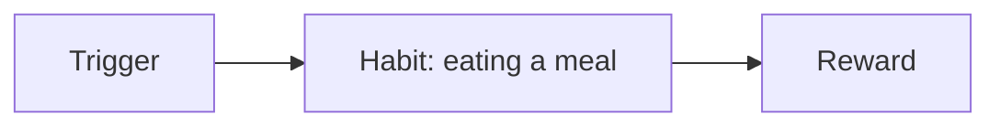

The ideal trigger is "to eat healthy and for my goals": the user's logic guides (changes, overrides, defines) their habits.

### 2.2 A habit

| Part | Definition |
| --- | --- |
| Main trigger | Time of day. It is the base of most diets and defines hunger, which is itself a habit: it comes at the times you're used to eating |
| Contextual triggers | Place, company, before/during/after an event, emotion, or anything else the AI finds. Sometimes they define a habit more than the time does |
| Common meals | 1–5 meals the AI summarizes from those logged under the trigger, each with average calories and macros from the user's history and a usefulness score ([§4.3](#43-usefulness)) |
| Rewards | Main: usefulness toward the user's goals. Others found by analysis: no hunger (though through fasting, hunger can be a friend), pleasure of eating, pleasure of the setting or company, coping with an emotion |

Trigger examples: on my way to work · alone at night (loneliness) · before working out · in the morning · when I'm with Mike · at the office lounge.

### 2.3 Weekly habit view

Each week the AI defines the user's 3–5 major habits. A week is the smallest window. The first analysis comes at the end of the onboarding week; a month gives a clearer picture.

- **Usefulness score:** [§4.3](#43-usefulness).
- **Diet share** (the notes' "diet-defining percentage", d.d.p.): the share of the week's calories a habit covers, kcal(habit) / kcal(week), shown as a plain percentage. Five non-overlapping habits covering the whole diet are 20% each, so 20% is already major.
- **Habit overlap:** a meal can belong to two habits and be counted twice; keep overlap minimal. It's measured in calories and is asymmetric: overlap(A→B) = kcal(A ∩ B) / kcal(A).

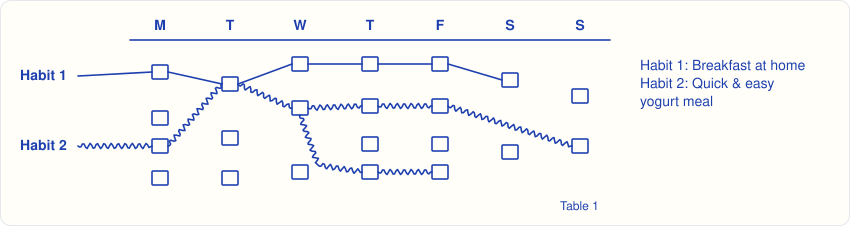

In this example Habit 1 overlaps Habit 2 by 20%, and Habit 2 overlaps Habit 1 by 15%.

### 2.4 Habit trends

Comparing week X with week X+1, a habit is:

- **Same:** usefulness stable.
- **Changed:** same trigger, different meal, big usefulness change. "When I have cravings at home": sweets → fruit.
- **Eliminated:** its trendline stops.
- **Emerged:** a new trendline starts.

A habit's identity is its trigger: habits keep stable IDs keyed by trigger, and each weekly analysis maps its groups onto existing habits before creating new ones. Without this there are no trends.

Trends are goal-dependent and need several weeks. Weeks analysed under older goals stay visible but marked as goal-mismatched (gray or shadow overlay), with goal-change moments shown and older goals viewable on click. Maybe also re-view trends through an older goal's lens; that's cheap, since scoring is code ([§9.1](#91-the-ai-extracts-code-scores)).

### 2.5 User phases

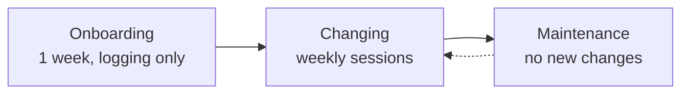

Maintenance needs research. Candidate ideas from the 7 Oct plan: meal logging drops to weekly, bodyweight stays daily plus a weekly questionnaire, interaction frequency adapts to the user.

## 3. Logging

_Notes: p0, p4–5, p7, p9–10, p12, p18, p28, p32–33._

### 3.1 Bodyweight

- Measured in the morning, after a full night's sleep and a possible toilet trip. Daily fluctuations are expected and must not discourage the user.
- One measurement per day, editable until the end of the next day. Huge jumps may be refused outright.
- Entered in the Weight Room ([§8.3](#83-weight-room)) or through chat.
- A scale is optional ([§6.3](#63-boundaries)).

### 3.2 Meals

- **Input:**
  - **Onboarding week: voice.** It gathers the most useful information, worth the extra friction, though speaking can be awkward in front of people.
  - **After onboarding:** logging leans on easy photos, common meals (old habits) and the dietitian sessions. Photos are processed into the user's common meals, then dropped ([§9.2](#92-data-rules)).
  - **Text**, through the input field or chat, works anytime.
  - **Common meals:** quick logging from a page inside the meal logger, updated weekly, with history.
  - **Shared meals** need no special feature: users describe them loosely ("a little of this and some of that, at a dinner with friends") and the AI estimates.
- **When:** per meal, ideally right after eating so the log time is enough, or the whole day at its end. Users pick the mode in onboarding ([§3.5](#35-reminders)).
- **Speed** is the main UX metric: a repeat meal in about two taps, a new one in one spoken sentence. Logs save instantly and get parsed in the background.
- **Clarifications:** the AI may ask for more information, or propose assumptions the user can delete. Both carry **communication risk (ComRisk)**: the chance that the AI's questions or assumptions burden users enough to disengage. Users can switch them off, or give the AI direct orders. To consider when building: show a parsed log as removable chips, inferred ones styled differently; deleting a chip rejects that assumption, so no question is needed.

### 3.3 Days

- A day runs 04:00–04:00 in the user's timezone. 04:00 is the middle of a typical night (sleep around midnight to 08:00): a practical default, easy to change later because days are derived from stored times ([§9.2](#92-data-rules)). For unstable sleepers, contextual anchors ("when I wake up", "before work", "at lunchtime") keep the app useful. Onboarding asks about sleep stability (and stomach).
- **Weeks** run Monday–Sunday and belong to the month their Monday falls in, numbered 1–5 within it (p32–33).
- **Parts of the day:** a predefined set of labels at first (morning · lunchtime · afternoon · night · midnight), maybe user-defined later. A label implies a rough time, so users can tag meals without being specific, which suits end-of-day logging. An exact time, when given, is a better data point.
- The **day page** shows the day's events in strict order. Users can reorder them; leaving without saving asks for confirmation.

### 3.4 Meal event

One eating occasion, made of one or more **items** (parts better logged separately). Caloric drinks and alcohol are items too, since they're often whole habits; water tracking is later.

| Field | Content |
| --- | --- |
| Time | Part of the day, plus the log timestamp |
| Name | User-given. May inform a future global meal DB |
| Size | Snack: small plate or handful < Normal: large plate < Large: heavy large plate, or large with a side < XL: until the stomach can't take more |
| Volume | Physical volume: how much the meal fills the stomach. The primary underlying metric for satiety: high satiety = high volume + low calories. Words like "filling" or "light" are combinations or wordings of the two. Protein and fiber add satiety too, so satiety will need a function of all four; research when building (grams per item may be the practical volume proxy; Rolls, *Volumetrics*; Holt et al. 1995) |
| Nutrition | Calories, protein, fat, carbs. AI estimates, good enough for guidance |
| Context | Place, company, emotion, way of eating (rushed, slow, mindful), each with a confidence: stated by the user ⟷ inferred, and how ([§9.2](#92-data-rules)) |
| Supply | Where the food came from, and whether the user controls it or others are involved |
| Price, prep time | Rough estimates, only if relevant to the user. Prep time excludes shopping |
| Goal value | Diet adherence under the goals at that time ([§4.3](#43-usefulness)) |

Each snacking occasion is its own event, so stacked snacks stay visible. A snack multiplier (1 · 2 · 3 · too many) counts portions within one.

### 3.5 Reminders

Only reminders the user agreed to. Onboarding sets them up together with the logging mode:

- **Per meal:** a couple of reminders during the day, timed from the user's habits once known (e.g. 30 minutes after their usual lunch). E.g. "I see you haven't logged any meals yet, and it's afternoon. Haven't you eaten at all?" with the answers *Not yet* and *Log them now*.
- **End of day:** one evening reminder.

A **day complete** mark tells the analysis which days are fully logged, so missing meals aren't read as undereating.

### 3.6 Data at a glance

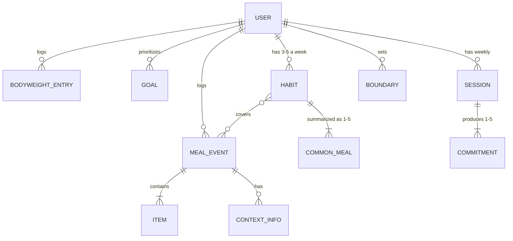

A commitment is either a habit change or a supply to-do ([§7](#7-food-supply)).

## 4. Goals and progress

_Notes: p10, p19–20, p23–25, p27._

### 4.1 Goals

Goals have a strict priority order agreed with the user: by default 1 > 2 > 3, reordered by drag and drop.

1. **Bodyweight:** healthy increase, healthy decrease, or stable.
2. **Diet adherence:** follow a diet ([§4.4](#44-diet-rules)). MVP: low carb and high protein. For fat loss, users can pick low carb or just focus on calories.
3. **Custom goal** (later): one free-text goal, e.g. a user-defined diet or meal cost. The AI judges meals and habits against a baseline, the first week's logs. It must state a single goal and must not be a security risk.

- Goals change at most once a week: scarcity builds commitment. A change applies from the current week; older weeks keep the goals they were scored under ([§9.2](#92-data-rules)).
- The bodyweight direction gets the wording the user prefers, picked from a predefined table, stored with the user and used by the AI whenever it talks to them. It changes with the goal.

  | Direction | Wording options |
  | --- | --- |
  | Surplus | "calorie surplus", "lean bulk" |
  | Deficit | "calorie deficit", "leaning phase", "cut", "fat loss" |
  | Maintenance | "stable", "maingaining" |

- A **goals page** shows the goals and their order.

### 4.2 Measuring progress

- Bodyweight is the **hard** evidence and logged calories are **soft**. We work out expenditure from both, so any counting bias ends up inside it. If someone logs less than they eat and their weight stays flat, we conclude they're in balance at the logged number. Expenditure is the free variable that counterbalances the calorie-logging bias. If the bias changes over time, we have to wait for the bodyweight trend to make it visible.
- So stable calorie estimates beat accurate ones ([§9.3](#93-ai-engineering-habits)). In ratios like diet share and overlap, a constant bias cancels entirely.
- During the onboarding week bodyweight is assumed stable (users are asked not to change habits, partly for this), so average logged intake ≈ expenditure. Logging alone changes behaviour, though, so this week isn't a pure baseline; little can be done about that. The week also gives the average number of meals per day.
- Bodyweight goal + this baseline → a **daily calorie goal**: a per-user value with a history. It starts from the rule of thumb ([§4.4](#44-diet-rules)), and each weekly analysis updates it from the bodyweight trend, using fully logged days only ([§3.5](#35-reminders)). Users mostly don't see it; the AI dietitian explains changes, e.g. "after this week's analysis, we'll aim for an X kcal deficit to keep you on track". There is no per-meal calorie goal.

### 4.3 Usefulness

Each goal weighs twice the next: w₁ = 2·w₂ = 4·w₃ and Σw = 1, i.e. 4/7, 2/7, 1/7 (2/3, 1/3 with two goals). Usefulness is the weighted sum over goals. **In the MVP, usefulness covers calories and diet adherence.**

| Goal | Meal | Day / week | Habit |
| --- | --- | --- | --- |
| Bodyweight | Later: needs the day's running calories | Calories vs daily calorie goal | Does it push toward over- or undereating? |
| Diet adherence | Do the diet's rules hold? | Same | Same |
| Custom (later) | AI judgment vs baseline | Same | Same |

Custom goals are the big unknown. Diet-like ones are easy; cost-like ones need rough meal prices and guardrails (never suggest abusing a relationship for free food).

To consider when building: put every goal's usefulness on one scale (e.g. 0–100) before weighting. With factor 2, goal 1 then always outweighs all lower goals combined, the strict priority intended.

### 4.4 Diet rules

Every rule needs study references before use ([§6.4](#64-library)). Metric units first.

- **Why macros matter:** protein and fat give high sustenance; fat must stay above zero for hormonal health; carbs give daily energy and training fuel, and may help anabolism (insulin, full glycogen stores); calories drive bodyweight. Satiety itself: [§3.4](#34-meal-event).
- **High protein ("hp"):** building muscle needs training, and quality training needs energy, so: high protein with enough carbs.

  | hp diet | Amount |
  | --- | --- |
  | Protein | 1.8 g/kg/day (?), e.g. 82 kg → ~150 g |
  | Fat | 0.65 g/kg/day |
  | Carbs | ≥ 100 g/day (uncertain reading) |
  | Progress | +0.25–0.5% bodyweight/week. Rule of thumb: +275 kcal/day ≈ +0.25 kg/week, the starting point for the calorie goal ([§4.2](#42-measuring-progress)) |

  To check when building: protein 1.8 sits inside the usual 1.6–2.2 g/kg; fat should stay within 20–35% of energy (0.65 g/kg can fall below 20% at high intakes); ≥ 100 g carbs is a floor, not a training target; fuelling training is a stronger reason for carbs than insulin. Start with Morton et al. 2018 and the ISSN protein position stand (2017).
- **Low carb:** offered for its natural satiety, mainly from protein, not as "best for fat loss": healthy low-carb and low-fat diets lose similar weight (DIETFITS, Gardner et al. 2018). Lower daily carbs gradually while the user can sustain the lower energy and the cravings. After the first hurdle (~1 week) the body finds a new equilibrium; sustained for ~1 month, it's easy to return to after a relapse. Tool: a daily carb allowance.

## 5. Onboarding

_Notes: p11, p15–19._

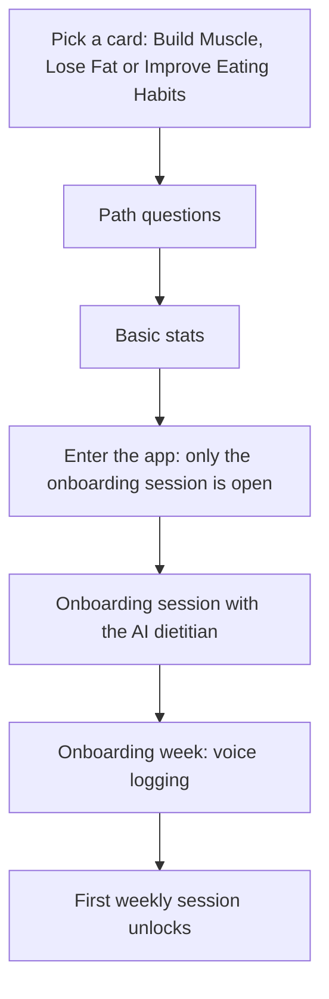

- **Asked along the way:** is a scale within reach on waking (asked first); sleep stability (and stomach); food supply habits and who else shapes them; deeper goals, e.g. lose fat → an upcoming wedding, build muscle → be more attractive or unlock athletic potential; the logging mode and its reminders ([§3.5](#35-reminders)).
- **Basic stats:** age; gender (male, female, other / prefer not to say); height; bodyweight, a rough estimate if no scale is at hand. Gathered at the end for better UX (p15), though the Build Muscle sketch asks first (p17).
- **Onboarding session:** clarify goals; define current problems (a sales step); set expectations (initial logging, a preview of what follows); commit to next steps (daily bodyweight and meal logging).

### 5.1 Build Muscle path

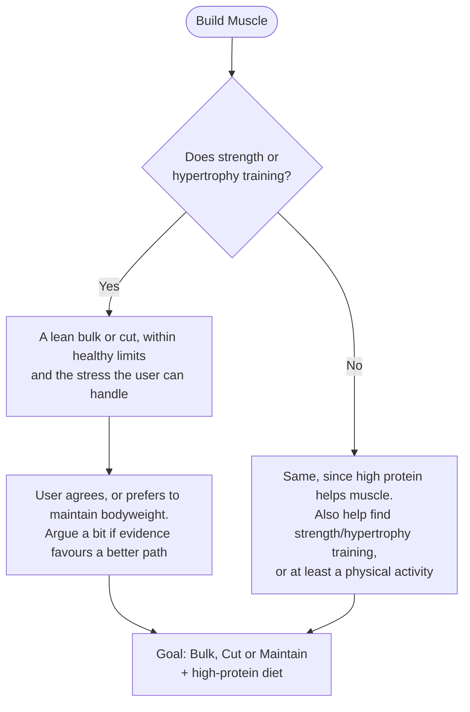

- The AI explains that diet helps, but proper strength or hypertrophy training is necessary; for beginners, even 2 full-body sessions a week (assumption). Training can't be supervised, so claims stay careful and come only from double-checked ones ([§6.4](#64-library)).
- Learn the user's minimum weekly activity sessions, and whether they are strength/hypertrophy.
- Users can require vegan-only protein options through a dietitian session.

### 5.2 Lose Fat path

Like Build Muscle, but the only acceptable outcomes are "cut" or "maintain with strength/hypertrophy training". Otherwise the AI insists on a realistic outcome that isn't "lose fat".

### 5.3 Improve Eating Habits path

Not defined yet.

### 5.4 Physical activity

- Always recommended: its benefits beat any pill. The AI can propose joining a gym, dance studio, martial arts class or hiking community, or at least a long-walk habit (mainly psychological benefits). A physical job counts.
- The user has the final say and can opt out for good ([§6.3](#63-boundaries)).

## 6. The AI dietitian

_Notes: p10–13, p16, p18, p27, p30._

The app's AI acting as the user's personal dietitian, with expert dietitian, behavioural-psychology and sales knowledge.

### 6.1 Comment on every log

| Phase | Comment |
| --- | --- |
| Onboarding | Thank them and encourage logging, with no judgment; a random message |
| Changing | Congratulate applied changes. When they fall short: be kind, show you noticed, offer a guilt-free way to log the reason and, if appropriate, solutions for next time |
| Maintenance | Probably like onboarding |

### 6.2 Weekly session

- One a week, for scarcity and realistic cooperation; the first comes after onboarding ([§5](#5-onboarding)).
- Before starting, the AI asks the user to be somewhere comfortable, with enough time for an important conversation.
- **Agenda:**
  1. Food supply habits: the highest-impact decisions ([§7](#7-food-supply)).
  2. Tactics: the most detrimental habits with the lowest-cost changes. Always prefer cheap options that fit the user's goals. Keep the timing and substitute the meal, within a similar taste palette. For variety, point to places to find alternatives. Use high-modifiability meals for step-by-step change or easy variation, e.g. a yogurt base (dessert-style with chocolate flakes, or with oats or fruit), or pasta as a cheap base.
- **Conversation rules:** prevent objections before recommending; keep messages short; ask for agreement before moving on, leaving room to object; handle objections; when useful, remind users of their ideal outcome and deeper goals. To research when building: Motivational Interviewing as the backbone, where users voice their own reasons (Miller & Rollnick), with the sales questions inside it; also COM-B and the behaviour change technique taxonomy (Michie et al. 2013).
- **Outcome:** 1–5 habit changes the user explicitly commits to for the next week, each an if-then plan on a habit's trigger: "When [trigger], I [new meal]" (Gollwitzer & Sheeran 2006). Since a habit's identity is its trigger ([§2.4](#24-habit-trends)), the logs show whether it happened. If unsure, users commit only to what they're certain of, but to at least one. The commitments are summarized at the top of the homepage.
- Advice involving other people (e.g. sharing your goals with your partner and asking for help) needs tact and strict guardrails.

### 6.3 Boundaries

The notes' "limiting dietitian beliefs": explicit rules users set for the AI, like "never ask me about exercise again" or "I don't use a scale". Listed in settings and undoable there; users are told so. Some hide features (workouts). For important ones the AI argues before accepting, e.g. the scale, the main progress measure.

### 6.4 Library

Small, important, memorable. It holds the double-checked claims, with study references, that the AI can use cheaply. Sections, one colour each: general dietary knowledge · habit-loop knowledge · major diets.

## 7. Food supply

_Notes: p5, p12–14, p29._

> "Best **place** to control a problem is **at** its source." ~Bboy Heavy Metal, 15.10.2026

- Supermarket and other supply habits are the "biggest battle" and the session's first topic. Changing the food environment beats relying on willpower (Wood, *Good Habits, Bad Habits*, 2019).
- **Supply page** (cart button): mostly read-only. Shows the supply habits from onboarding, noting where other people shape them (usually saving time or money). Changes only through dietitian sessions.
- At its top, a **to-do list** of agreed changes, each marked done after a confirmation prompt:
  - [ ] Next time at the supermarket, buy fruit instead of sweets, to eat freely when cravings hit
  - [ ] Bring a homemade protein shake to university, since the lounge has no high-protein meals
- To-dos also float on the homepage as advice bubbles ([§8](#8-screens)).

## 8. Screens

_Notes: p13–14, p29–33._ Mobile first; UX takes priority.

### 8.1 Homepage

| Element | Behaviour |
| --- | --- |
| Weekly commitments | At the top ([§6.2](#62-weekly-session)) |
| Settings gear | Account info, boundaries, the rest |
| Help (?) | Explains the advice bubbles and how the app is used. After the first slices |
| Advice bubbles | Animated and floating. Hold → more info and actions (mark done, go to its page). Tap 4× → a fun destruction, replaced by a different bubble. Users do both once at sign-up. Outline colour = source (below) |
| Dietitian Room | New-session button: gray and locked, with a weekly unlock bar showing the days left; colourful when open |
| Meal Log | Big button beneath the Dietitian Room |
| Weight Room | Small scale button, two states: logged today or not ([§8.3](#83-weight-room)) |
| Library | Small book button |
| Supply | Small cart button, one state |

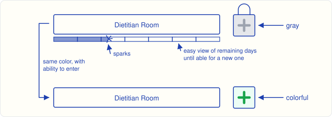

Advice bubble sources:

- **Library:** general and habit knowledge, rules of thumb.
- **Scale:** "log your weight for the day! :D", plus positive goal-related messages. Now and then, harsher facts from the dietitian when necessary.
- **Dietitian:** diet-adherence advice; personal reminders from sessions.
- **Meal log:** "don't forget to log your meals today! :D"
- **Supply:** personalized supermarket advice.
- **Menstrual cycle** (female users): in the MVP only one general advice: the cycle can shift bodyweight noticeably, so keep weighing.

The tone stays positive, with a smiley that reads friendly to everyone.

### 8.2 App map

Dotted: placement not decided in the notes.

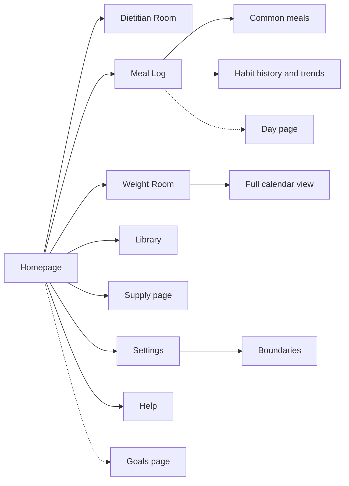

### 8.3 Weight Room

Sketched on p32–33 as the "Weight Viewer". Details get specified when the feature is built.

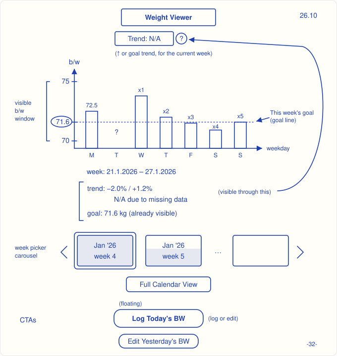

- **Week chart:** one bar per day, Monday to Sunday ([§3.3](#33-days)), on a weight window of about 5 kg: small enough for differences to show, large enough to fit the data. Missing days show "?". A dotted line marks this week's goal weight.
- **Header:** the week's trend (% change), or the goal trend for the current week. Its "?" shows the details: the trend or "N/A due to missing data", and the goal.
- **Week picker:** a carousel of week cards ("Jan '26 week 4"), each filled with a soft colour whose height shows how many of the 7 days are logged. The selected week sits in the centre, except the first or last.
- **Buttons:** a floating "Log today's BW", which logs or edits today's weight, and "Edit yesterday's BW" ([§3.1](#31-bodyweight)). "Full calendar view" sits under the picker.
- **Full calendar view:** months as rows, newest on top, and weeks 1–5 as columns. Each week shows its average weight as a point on a line, with its trend % above. Value labels sit away from the line, and the line turns dotted where an average comes from far-away values or missing data. Each month row gets its own weight window, sized so every visual fits.

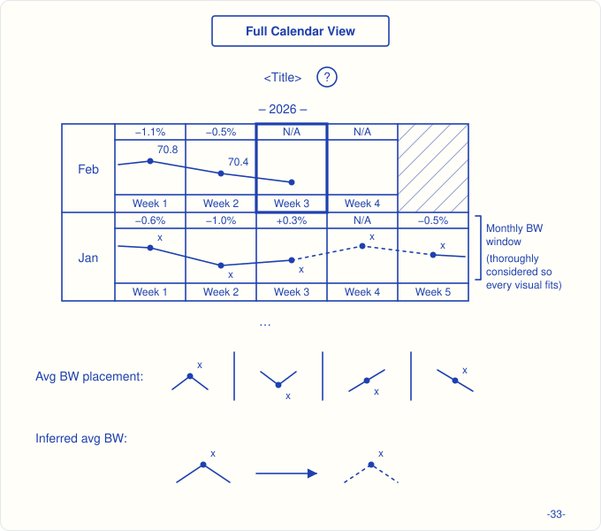

To consider when building: bars that don't start at zero exaggerate small daily swings, which can discourage (p18); points or a line may read more honestly on a narrow window.

## 9. Technical foundations

_Accepted from the council review, 23–27 Oct._

### 9.1 The AI extracts, code scores

| Job | Done by |
| --- | --- |
| Turn a log (text, voice transcript, photo) into meal events and items with nutrition estimates, in English | LLM |
| Group a week's events into 3–5 habits and match them to existing ones ([§2.4](#24-habit-trends)) | LLM |
| Comment on logs; run onboarding and weekly sessions | LLM |
| Days, weeks, parts of day, units, unlocks, reminders | Code |
| Expenditure, calorie goal, bodyweight trend | Code |
| Diet-adherence rules, usefulness, diet share, overlap, trends | Code |

Extraction doesn't depend on goals; scoring does. So changing goals, or viewing old weeks through another goal, re-runs arithmetic, not the LLM. The custom goal is the exception: judging free text needs the LLM. Scores stay explainable and unit-testable.

### 9.2 Data rules

| Topic | Rule | Why |
| --- | --- | --- |
| Raw input | Keep the user's original words (text or transcript). Don't keep raw audio or photos after processing | Re-parse old logs with better prompts or models; privacy; storage |
| AI outputs | Tag each with its prompt and model version | Know what to recompute; compare versions |
| Time | Store when eaten as a UTC instant + IANA timezone, flagged as approximate when it comes from a part-of-day label; store when logged separately. Derive the day, week and part of day | End-of-day logging, travel, daylight saving |
| Goals, calorie goal | Version them with start dates; never overwrite | Goal-mismatched overlays, lenses and the calorie-goal history need it |
| Units | Store kg, g, kcal; convert at display | Imperial later costs nothing |
| Confidence | Keep stated, inferred, confirmed and rejected values apart, plus the method behind each inference (e.g. AI parse, habit trend, photo) | Trust, corrections, deleting assumptions |

### 9.3 AI engineering habits

- Structured outputs (JSON schema) for parsing and habit analysis, validated before saving.
- Prompts in versioned files.
- An evaluation set per LLM job, from Odysseas's own logs: expected items, size and part of day, and a hand-made habit grouping. Also stability: the same week analysed twice gives the same habits. Each set runs against models from different providers, to pick a model per job.
- **Stable calorie estimates** ([§4.2](#42-measuring-progress)): repeat meals reuse their common-meal values instead of being re-estimated; after a model or prompt change, history is re-estimated (outputs are versioned, [§9.2](#92-data-rules)). Test estimate stability before accuracy.
- The custom goal (later) is user text inside a prompt: treat it as data, never instructions (prompt injection).
- The library ([§6.4](#64-library)) is the AI's only source of health claims. It's small enough to sit in the prompt; no vector search at first.

### 9.4 Stack

| Part | Decision |
| --- | --- |
| Client | React Native + Expo (locked 27 Oct): popular, long-lived, one TypeScript codebase, the best support from AI coding agents |
| Backend and database | Open. Proposal: relational, Postgres on Supabase ([database-analysis.md](database-analysis.md)) |
| LLM | Provider-agnostic, so each job can compare models from different providers. Vercel AI SDK + promptfoo for now; details when building |
| Connectivity | Online only: offline-first costs too much for a first app |

## 10. Scope

### 10.1 MVP slices

The core comes first. The slices test the two riskiest assumptions: that people log daily, and that the AI turns rough logs into habits that reveal something new.

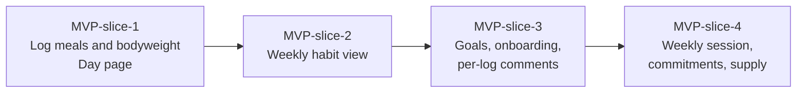

- **MVP-slice-1:** single user; no accounts, no payments. Voice through the phone keyboard's dictation. Odysseas tests it personally for 2 weeks; done when at least 12 of 14 days are logged.
- **MVP-slice-2:** habits, common meals, diet share, overlap and trends; usefulness comes with goals in slice 3. Done when, run on the slice-1 logs, it shows Odysseas something new.
- **Later MVP slices:** the rest of sections 1–8, except [§10.2](#102-later), ordered when we get there.

### 10.2 Later

| Area | Items |
| --- | --- |
| Logging | Hydration and liquid intake; workouts as day events; stomach-fullness tracking, to predict hunger and advise after heavy meals; a global meal DB; photo history, much later, for users who like keeping food photos |
| Goals | Custom goal; keto; per-meal bodyweight usefulness; a workout-rules section on the goals page; imperial units |
| AI dietitian | A user-chosen character; a short per-user md file defining how the AI speaks; a recipe book |
| Screens | Exercise page (works like the supply page) and exercise advice; menstrual-cycle tracking and advice; hydration entry point; a brief app overview after onboarding |
| Support | Complaint service: chat-like, with requests |

### 10.3 Parked until a prototype exists

- **Monetization:** a 1-month free trial with visible results by its end; paying to unlock analysis after the onboarding week, with a discounted first payment (or a cheaper first 6–12 months); goals locked during the trial unless buying; affiliate income (yogurt, food places).
- **Legal:** advice involving other people; health claims; the 7 Oct plan's Greece/EU checklist (§12 of `git show 83026e4:administration/docs/product-plan.md`).

## 11. Open questions

- Prior work: how do other apps do it? (README, p1; a later phase)
- Gamification in general (p8). Usefulness is defined; the rest isn't.
- How a habit's push toward over- or undereating is judged ([§4.3](#43-usefulness)). Council suggestion: score bodyweight per day and week only, at first.
- The Improve Eating Habits path ([§5.3](#53-improve-eating-habits-path)).
- Onboarding safety, when building onboarding: an eating-disorder screening question and a stop-and-refer rule; no deficit for underweight users; adults only.
- Maintenance: when it starts and how it behaves ([§2.5](#25-user-phases)).
- How daily diet rules (g/kg/day) judge a single meal or a habit.
- How the app's AI recalls a user's history in a session (Odysseas's homework: agentic retrieval vs vector RAG).
- Cost per active user per day (about 5 parses and 5 comments, plus the weekly analysis and session), before choosing models.
- Slice-1 setup: accounts or one hard-wired user; Expo's push service or FCM; what runs on the phone and what in functions.
- Global meal DB: structure and meal families (p7).
- Diet rules: references, the protein "(?)", the carb reading (p27).
- Brain fog: an outcome (p1) and a meal danger (p2), not yet a feature.
