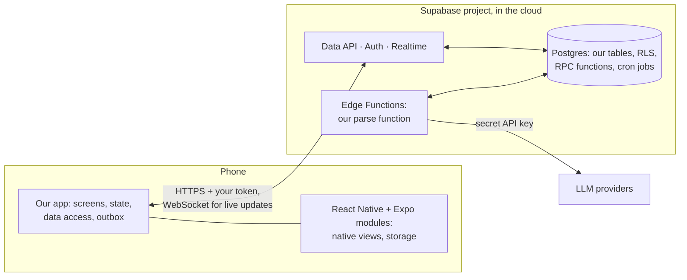
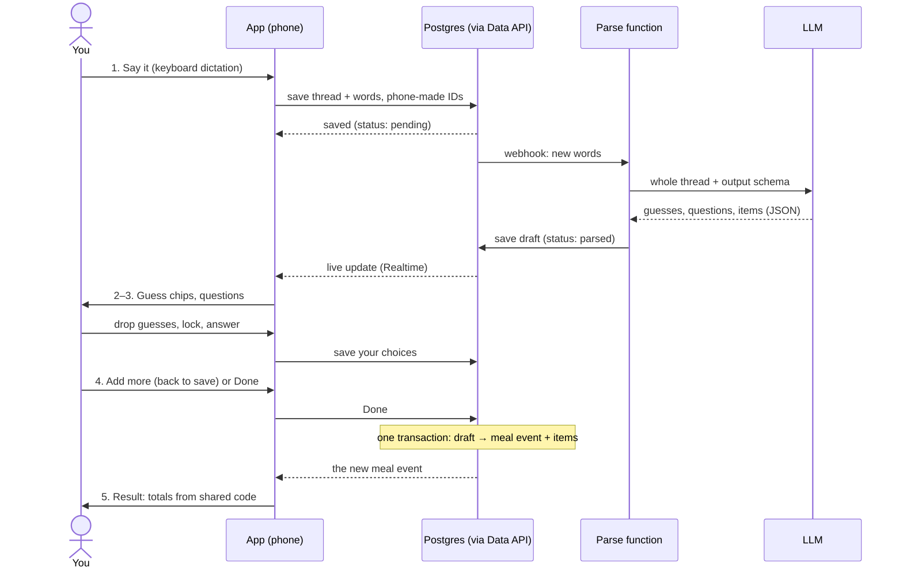
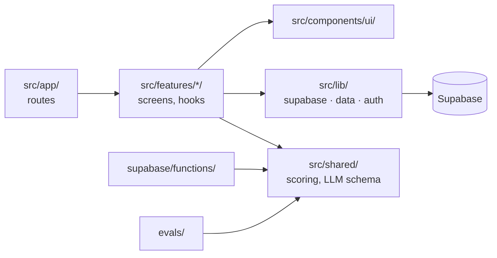

# Tech Stack and Codebase

**28 Oct 2026.** How the app's technologies fit together, where our code lives, and how agents work on it in parallel. Facts checked against the official docs on 27–28 Oct 2026. Stack decisions: [plan §9.4](product-plan.md#94-stack). Backend rules: [database-analysis.md §6](database-analysis.md#6-proposal).

## Contents

1. [The picture](#1-the-picture)
2. [One meal log's journey](#2-one-meal-logs-journey)
3. [Keys and access](#3-keys-and-access)
4. [Folders](#4-folders)
5. [Working with agents](#5-working-with-agents)
6. [Official docs](#6-official-docs)

## 1. The picture

- **Phone:** our app is TypeScript written with React. React Native draws it as real native views. Expo adds native modules as packages, navigation where each file is a screen, and the build tools. A JavaScript change reaches the phone at once; a library with native code needs a new build.
- **Supabase:** a hosted Postgres with services around it: an HTTP API generated from our tables, sign-in, live updates, and Edge Functions, where our server code runs.
- **LLM:** called only from an Edge Function. Its API key costs money per call, and anything shipped in the app can be extracted.
- **The AI extracts, code scores** ([plan §9.1](product-plan.md#91-the-ai-extracts-code-scores)): the LLM turns words into data; our code computes totals and scores.
- **Exit seams:** our code reaches Supabase only through our own modules, so the platform stays replaceable ([guardrail 13](database-analysis.md#6-proposal)).

## 2. One meal log's journey

*Open, decided when the log thread is grilled:* who starts the parse (a database webhook, or the app after saving), and live updates or polling.

## 3. Keys and access

Grants decide whether a role may touch a table at all; RLS decides which rows. New tables get no grants by default since 2026, so each migration grants explicitly. Constraints check every write, even from functions that bypass RLS.

| Key | Lives | Can do |
| --- | --- | --- |
| Publishable (`sb_publishable_…`) | In the app; public by design | Only what grants and RLS allow |
| Your access token | On the phone, after sign-in | Identifies you to RLS (`auth.uid()`) |
| Secret (`sb_secret_…`) | Function secrets only | Bypasses RLS, not constraints |
| LLM API keys | Function secrets only | Spends money per call |

The legacy `anon` and `service_role` keys are deprecated by the end of 2026, but agents trained on older examples still reach for them.

## 4. Folders

One Expo project at the repo root, with `supabase/` inside it. A folder appears when a step first needs it. A feature's code may span several folders: the aim is parallel agent work ([§5](#5-working-with-agents)), not one folder per feature.

Arrows are imports; lint blocks the rest ([§5](#5-working-with-agents)).

| Path | Holds | Runs on |
| --- | --- | --- |
| `src/app/` | Routes and layouts only (Expo Router): one-line files exporting a screen from its feature | Phone |
| `src/features/<feature>/` | Screens, components, hooks in `api.ts` (TanStack Query), tests | Phone |
| `src/components/ui/` | UI pieces that two or more features use | Phone |
| `src/lib/` | `supabase.ts`, the only Supabase client; `data/<feature>.ts`, all reads and writes as plain functions; `auth.ts`, sign-in and the current user; later `outbox.ts` | Phone |
| `src/shared/` | Plain TypeScript, free of React and Supabase: scoring, the LLM output schema | Phone, functions, Mac |
| `supabase/migrations/` | The schema as ordered SQL: tables, grants, RLS, RPC functions | Postgres |
| `supabase/functions/<name>/` | One Edge Function: a thin `index.ts` around plain modules | Edge Functions (Deno) |
| `supabase/tests/` | pgTAP tests, at least one per table | Local stack, CI |
| `evals/` | promptfoo configs and datasets ([plan §9.3](product-plan.md#93-ai-engineering-habits)) | Mac, CI |
| `.github/workflows/` | CI running the checks | GitHub |

- **Conventions:** kebab-case file names; `@/` imports instead of `../`; tests beside their code as `*.test.ts(x)`, never in `src/app/`, where every file is a route.
- **Open risk:** Deno may not resolve imports from `src/shared/`. Setup step 9 tests it; if it fails, the folder moves to `supabase/functions/_shared/`.

**Feature map.** Each feature ticket keeps its row current.

| Feature | Phone | Data | Backend |
| --- | --- | --- | --- |
| `auth` | `src/features/auth/` | `src/lib/auth.ts` | Supabase Auth, sign-ups off |
| `day` | `src/features/day/` | `src/lib/data/day.ts` | Reads meal events and bodyweights |
| `bodyweight` | `src/features/bodyweight/` | `src/lib/data/bodyweight.ts` | `bodyweights` table |
| `meal-log` | `src/features/meal-log/` | `src/lib/data/meal-log.ts` | Log-thread and meal tables, `parse-log` function |

## 5. Working with agents

The aim: several agents at work at once, none touching another's files, each proving its work without the phone.

| Check | Runs | When |
| --- | --- | --- |
| `npm run check` | TypeScript, ESLint with Prettier, Jest | Before calling any change done; CI on every pull request |
| `npm run test:db` | pgTAP on the local Supabase stack | When `supabase/` changed; CI |
| `npm run evals` | promptfoo | When a prompt or model changed; comes with `parse-log` |

- **One owner per file.** Expo Router needs no central route list, so a new screen is a new file. Shared files (`_layout.tsx` files, `src/components/ui/`, `src/lib/supabase.ts`, `package.json`) change in small tickets of their own. No `index.ts` barrels that every feature edits.
- **Typed edges.** Features meet only through `src/lib/` and `src/shared/`. Lint stops a feature importing another feature, and anything outside `src/lib/` importing Supabase.
- **One worktree per agent,** each with its own branch and `npm install`.
- **Database changes go one at a time.** All worktrees share one local Supabase stack, and migrations run in order. Phone-only tickets run in parallel.
- **Regenerate, don't merge.** On a conflict in `package-lock.json` or the database types, rerun `npm install` or `npm run gen:types`.
- **Area rules** live in the area's `AGENTS.md`, the first being `supabase/AGENTS.md` (setup step 6). A section of the root `AGENTS.md` links to it as a plain link: an `@` import would load the rules into every session ([docs](https://code.claude.com/docs/en/memory#agents-md)), while a link is read only for that area's tasks.

## 6. Official docs

Check the docs for the installed version before using an API: Expo, React Native and Supabase change with every release.

| Technology | Docs | Start with |
| --- | --- | --- |
| TypeScript | [typescriptlang.org](https://www.typescriptlang.org/docs/) | |
| React Native | [reactnative.dev](https://reactnative.dev/docs/getting-started) | [Core Components and Native Components](https://reactnative.dev/docs/intro-react-native-components) |
| Expo SDK 58 | [docs.expo.dev](https://docs.expo.dev/versions/v58.0.0/) | [Expo Router core concepts](https://docs.expo.dev/router/basics/core-concepts/) · [Expo Go & development builds](https://www.youtube.com/watch?v=FdjczjkwQKE) (video, 22 min) |
| Supabase | [supabase.com/docs](https://supabase.com/docs) | [Architecture](https://supabase.com/docs/guides/getting-started/architecture) · [Use Supabase with Expo](https://supabase.com/docs/guides/getting-started/quickstarts/expo-react-native) |
| TanStack Query | [tanstack.com/query](https://tanstack.com/query/latest/docs/framework/react/overview) | [React Native](https://tanstack.com/query/latest/docs/framework/react/react-native) |
| Jest, React Native Testing Library | [jestjs.io](https://jestjs.io/docs/getting-started) · [RNTL](https://callstack.github.io/react-native-testing-library/) | [Expo's unit testing guide](https://docs.expo.dev/develop/unit-testing/) |
| ESLint, Prettier | [eslint.org](https://eslint.org/docs/latest/) · [prettier.io](https://prettier.io/docs/) | [Expo's ESLint guide](https://docs.expo.dev/guides/using-eslint/) |
| pgTAP | [pgtap.org](https://pgtap.org/documentation.html) | [Supabase's testing overview](https://supabase.com/docs/guides/local-development/testing/overview) |
| GitHub Actions | [docs.github.com](https://docs.github.com/en/actions) | |
| Vercel AI SDK | [ai-sdk.dev](https://ai-sdk.dev/docs/introduction) | With the parse function |
| promptfoo | [promptfoo.dev](https://www.promptfoo.dev/docs/intro/) | With the evals |

For ideas, not rules: the [Obytes template][obytes] for app structure, and [Supabase's Expo example][sb-example] for Supabase wiring.

[obytes]: https://github.com/obytes/react-native-template-obytes/tree/fd9b358ed11913d2a49fd9ffa6582fe03ba130e7
[sb-example]: https://github.com/supabase/supabase/tree/2a8dc75e3d89f590cdc427a1f65273c910508575/examples/user-management/expo-user-management
