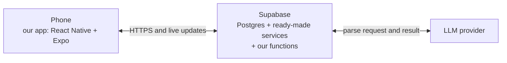
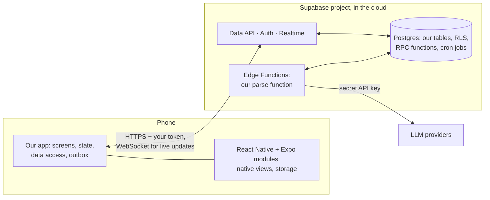
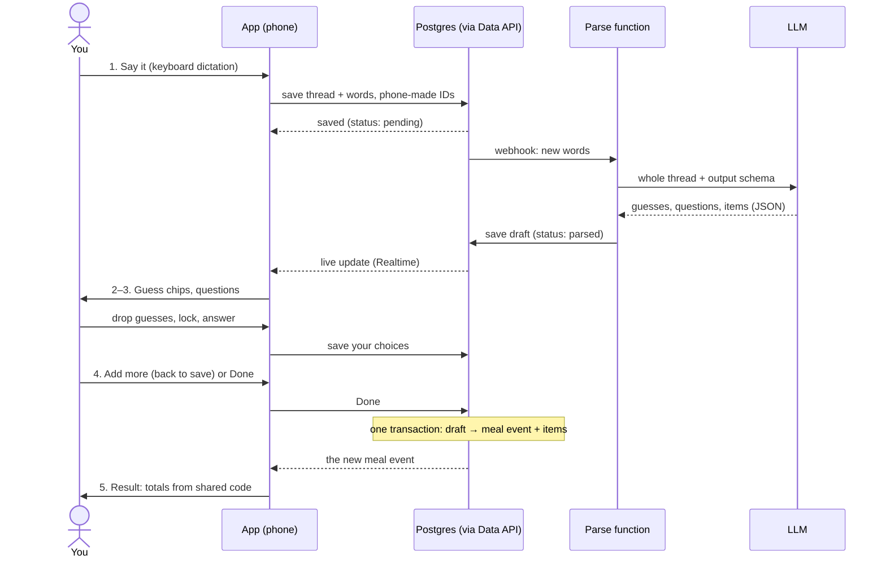
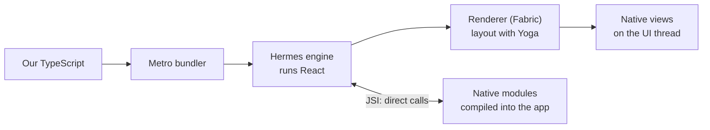
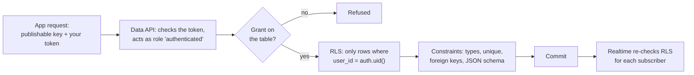
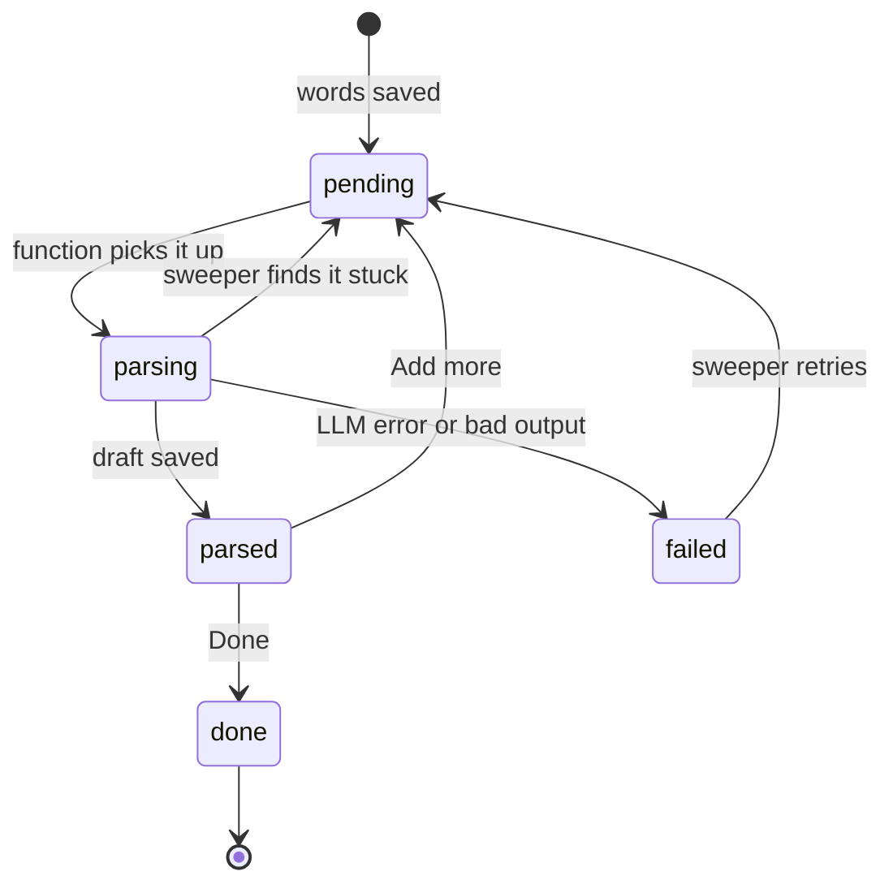

# Tech Stack — The Big Picture

**27 Oct 2026.** How React Native + Expo and Supabase work together in our app, at three depths, following one meal log through its thread ([plan §3.2](product-plan.md#the-log-thread)). Facts checked against official docs on 27 Oct 2026. Design marked *open* gets decided in a later grilling. Stack decisions: [plan §9.4](product-plan.md#94-stack); backend design: [database-analysis.md](database-analysis.md).

## Contents

1. [Level 1: the picture](#1-level-1-the-picture)
2. [Level 2: one meal log's journey](#2-level-2-one-meal-logs-journey)
3. [Level 3: under the hood](#3-level-3-under-the-hood)
4. [Watch first](#4-watch-first)

## 1. Level 1: the picture

- **Phone:** our app is TypeScript written with React. React Native draws its components as real native views, not a web page. Expo is the toolkit around it: native modules as packages, navigation where each file is a screen, and the service that builds an installable app.
- **Supabase:** our backend. A hosted Postgres database with services around it: an HTTP API generated from our tables, sign-in, live updates, and server functions where our backend code runs.
- **LLM:** called only from a Supabase function. Its API key costs money per call, and anything shipped inside the app can be extracted.
- **One meal log:** the app saves your words in Postgres; a function asks the LLM to parse them and saves the result; the screen updates by itself.
- **The rule behind it:** the AI extracts, code scores ([plan §9.1](product-plan.md#91-the-ai-extracts-code-scores)). The LLM turns words into data, including each item's nutrition estimate; totals, days and scores come from our code.

## 2. Level 2: one meal log's journey

### 2.1 Where each piece of code runs

| Our code | Runs on | Written in |
| --- | --- | --- |
| Screens, components, client state, data-access and auth modules, outbox | Phone, inside the app | TypeScript (React) |
| Shared scoring package | Phone, functions, Mac (evals) | TypeScript |
| Parse function and other function logic, with their prompts | Supabase Edge Functions | TypeScript (Deno runtime), prompt files |
| Schema, constraints, RLS policies, RPC functions, cron jobs | Postgres, shipped as SQL migrations | SQL |
| Evals, re-parse scripts | Mac and CI | TypeScript, promptfoo |

While building, three more things run: **Metro** on the Mac bundles our TypeScript and sends it to the phone on every save; the **Supabase CLI** runs the same backend locally in Docker for tests; **EAS**, Expo's cloud, builds the installable app.

### 2.2 The journey

| Step | Where | Why there |
| --- | --- | --- |
| Save the words | Phone → Data API → Postgres | Words are raw input, which clients may write. RLS checks the row is yours, constraints check its shape, phone-made IDs make a retry harmless |
| Parse | Edge Function | It holds the LLM key, and it keeps going if the phone loses signal |
| Show guesses | Postgres → Realtime → phone | The screen updates when the draft lands, without asking repeatedly |
| Drop, lock, answer, Done | Phone → Postgres | Your choices are raw input too |
| Draft becomes rows | Postgres, in an RPC function | Several tables in one transaction, which supabase-js can't do; nutrition numbers never come from the client |
| Result, day page | Phone, shared scoring package | Totals computed from the items' estimates. The day page is one query over a time range |

*Open:* who starts the parse (a database webhook, or the app after saving), and live updates or polling.

### 2.3 What each platform gives us

| | Gives us | We write |
| --- | --- | --- |
| React Native | React components drawn as native views; the JavaScript engine; core components (`View`, `Text`, `TextInput`, lists) | Screens and components |
| Expo | Native modules as packages; Expo Router (each file in `src/app/` is a screen); the dev server; development builds; EAS cloud builds, over-the-air updates and push notifications | Route files, app config |
| Supabase | Postgres and its extensions; the Data API generated from our tables; Auth; Realtime; Edge Functions; Cron and Queues; the dashboard; a CLI with a local stack, migrations, type generation, database tests and security advisors | Schema, RLS policies, RPC functions, the parse function, prompts, evals |

Our code reaches Supabase only through modules of our own, so the Supabase box stays replaceable ([database-analysis.md §6](database-analysis.md#6-proposal), guardrail 13).

## 3. Level 3: under the hood

### 3.1 From TypeScript to pixels

- **Two kinds of code in the app.** JavaScript (ours, bundled by Metro) and native code (React Native and Expo modules, compiled into the app binary). Changing JavaScript needs no new build: in development Metro sends it on every save; after release, EAS Update ships it over the air. Adding a native module needs a new build.
- **Hermes** runs the JavaScript on the phone. React computes what the screen should show; the renderer lays it out with Yoga (Flexbox, no CSS cascade) and creates real views (`UIView` on iOS, `ViewGroup` on Android). Since React Native 0.82 everything runs on the New Architecture, where JavaScript calls native code directly through JSI; the asynchronous "bridge" in older videos is gone.
- **Expo Go vs a development build.** Expo Go is a prebuilt app with a fixed set of native modules; Expo calls it an educational tool, and its version for a new SDK reaches the stores weeks after release. A development build is our own Expo Go: our native modules plus the dev tools, installed once, then reloaded from Metro.
- **No native folders to maintain.** Expo generates the `ios/` and `android/` projects from the app config (continuous native generation), so we write TypeScript and config only.

### 3.2 What a request may do

- **Your token** comes from Supabase Auth at sign-in, is stored on the phone and tells Postgres who you are (`auth.uid()`). How slice 1 signs in without accounts is *open*.
- **Grants decide if a role may touch a table at all; RLS decides which rows.** Since 2026 new tables get no grants by default (all existing projects from 30 Oct 2026), so each migration grants explicitly. Constraints check every write, even from functions that bypass RLS.

| Key | Lives | Can do |
| --- | --- | --- |
| Publishable (`sb_publishable_…`) | In the app; public by design | Only what grants and RLS allow |
| Your access token | On the phone, after sign-in | Identifies you to RLS |
| Secret (`sb_secret_…`) | Function secrets only | Bypasses RLS, not constraints |
| LLM API keys | Function secrets only | Spends money per call |

The legacy `anon` and `service_role` keys are deprecated by the end of 2026, but agents trained on older examples still reach for them.

### 3.3 How the parse survives failures

- The database webhook (`pg_net`) fires once: it waits 2 seconds by default and never retries. So the function answers at once and keeps working in the background (`EdgeRuntime.waitUntil`).
- A function run lasts at most 150 s on the free plan and 2 s of CPU per request. Waiting for the LLM is network I/O, so it doesn't count as CPU.
- A parse status on each thread, plus a cron job that re-sends threads stuck too long, means every log ends parsed or visibly failed. Re-running must be harmless: the draft is replaced, never appended.

*Open, a sketch of the statuses:*

## 4. Watch first

In order, about 55 minutes. All links checked on 27 Oct 2026.

| # | What | Type | Why |
| --- | --- | --- | --- |
| 1 | [React Native in 100 Seconds](https://www.youtube.com/watch?v=gvkqT_Uoahw) (Fireship) | Video, 2 min, 2021 | The core idea. Its "bridge" is outdated ([§3.1](#31-from-typescript-to-pixels)) |
| 2 | [Core Components and Native Components](https://reactnative.dev/docs/intro-react-native-components) (React Native docs) | Read, 3 min | How a `<View>` becomes a native view |
| 3 | [Expo Router core concepts](https://docs.expo.dev/router/basics/core-concepts/) (Expo docs) | Read, 5 min | A file is a screen: this shapes our folders |
| 4 | [Expo Go & Development Builds: Which should you use?](https://www.youtube.com/watch?v=FdjczjkwQKE) (Expo) | Video, 22 min, 2024 | The build model for your phone. Expo Go's store situation changed in 2026 ([§3.1](#31-from-typescript-to-pixels)) |
| 5 | [Supabase in 100 Seconds](https://www.youtube.com/watch?v=zBZgdTb-dns) (Fireship) | Video, 3 min, 2022 | The whole product at once; the dashboard has changed since |
| 6 | [Architecture](https://supabase.com/docs/guides/getting-started/architecture) (Supabase docs) | Read, 5 min | Each service in the Supabase box of [§2.1](#21-where-each-piece-of-code-runs) |
| 7 | [Use Supabase with Expo React Native](https://supabase.com/docs/guides/getting-started/quickstarts/expo-react-native) (Supabase docs) | Hands-on, 15 min | Both halves talking, with the publishable key and RLS |
