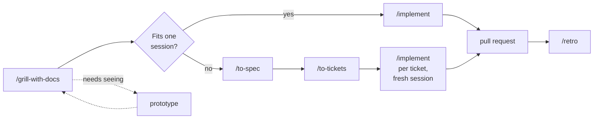

# Matt Pocock's skills

We build features with Matt Pocock's [skills](https://github.com/mattpocock/skills) (v1.3.2, Oct 2026). They're copied into `.claude/skills/`, so you can read each skill, and each update, as plain files.

- [The main flow](#the-main-flow)
- [Skills by use](#skills-by-use)
- [House rules](#house-rules): what this repo adds
- [Install and update](#install-and-update)

## The main flow



The skills target the four ways agents fail ([Matt's README](https://github.com/mattpocock/skills#why-these-skills-exist)): grilling fixes misalignment, the glossary fixes verbosity, tests and checks fix broken code, and deep modules stop the codebase turning into a ball of mud.

## Skills by use

A leading `/` marks the skills only you can start, by typing them. The agent can also start the others by itself.

### Every feature

- `/grill-with-docs`: interviews you about the change in numbered rounds, each question with a recommended answer, until nothing is assumed. Writes settled terms to `GLOSSARY.md`, and the rare big decision to `docs/adr/`. Start here
- `/implement`: builds the change, or one ticket, test-first, has it reviewed, and commits to the current branch
- `tdd`: one failing test at an agreed seam, then just enough code to pass it, slice by slice. `/implement` uses it
- `code-review`: two fresh reviewers in parallel check the diff, one against the spec, the other against our coding standards and Fowler's code smells. `/implement` runs it. Claude Code's own bug-hunting review stays reachable as `/review`
- `pr`: the shape of a PR description: the smallest picture of the change, before/after proof, and merge danger (one-way or two-way door, blast radius)
- `/retro`: before you clear a session, suggests fixes to the agent's environment (checks, pointers, standards). You pick which to keep; it applies nothing by itself

### Often, as needed

- `/wait-what`: re-explains the last message in plain English, in glossary words
- `prototype`: throwaway code for a question talk can't settle: UI variants to click through, or a sandbox for logic
- `research`: a background agent reads primary sources and writes a cited Markdown file
- `diagnosing-bugs`: for a hard bug: first a command that fails on it, then narrow it down, fix it and keep a regression test
- `/handoff`: compacts the session into a document another session can pick up
- `/ask-matt`: tells you which skill fits where you are

### Bigger features (more than one session)

- `/to-spec`: turns the grilling conversation into a spec issue: problem, solution, user stories, test seams. Run it in the same session as the grilling
- `/to-tickets`: cuts a spec into vertical slices, database to screen, each sized for one fresh session and linked to the tickets that block it

### Every few days

- `/improve-codebase-architecture`: finds shallow modules worth deepening, shows them in an HTML report, then grills the one you pick

### Rare

- `/implement-spec`: builds a whole spec at once, one parallel agent per ready ticket, on one integration branch
- `/wayfinder`: for an effort too foggy to spec: a map of decision tickets, settled one by one
- `/triage`: moves issues you didn't write (bug reports, requests) through labels into agent-ready briefs
- `/to-questionnaire`: turns a question only someone else can answer (a real dietitian, a lawyer) into a questionnaire for them
- `wizard`: writes a step-by-step script for steps only you can do, such as dashboards and secrets
- `/teach`: lessons on a topic over many sessions, in a workspace of their own
- `/grill-me`: grilling with no repo and no docs, for plans outside code

### Once

- `/setup-matt-pocock-skills`: sets the issue tracker (GitHub), the triage labels, and where the glossary and ADRs live. Writes `docs/agents/` and a block in `AGENTS.md`

### Building blocks

Other skills load these; you rarely call them yourself.

- `grilling`: the interview behind `/grill-with-docs`, `/grill-me`, `/triage` and `/wayfinder`
- `domain-modeling`: keeps `GLOSSARY.md` and the ADRs
- `codebase-design`: the deep-module vocabulary: module, interface, seam, depth
- `writing-for-agents`: how to write skills and `AGENTS.md`; `/retro` uses it

## House rules

1. **A feature lands through a pull request you merge, after your own review and tests.** Its session runs in its own worktree and branch, never on `main`. No agent merges or turns on auto-merge, unlike Matt's repo, where pull requests auto-merge once CI passes.
2. **New to you.** A PR description ends with up to 3 concepts the diff uses that I haven't met yet, each linked to its line and explained in one sentence.
3. **The glossary starts from the product plan.** `domain-modeling` drafts a new term from [product-plan.md](../../../product-plan.md)'s wording; the plan then links to the glossary instead of defining the term again.

## Install and update

Installed with:

```bash
npx skills@latest add mattpocock/skills -a claude-code --copy -y --skill setup-matt-pocock-skills ask-matt grill-with-docs grill-me grilling domain-modeling wait-what prototype to-spec to-tickets implement implement-spec tdd codebase-design code-review pr retro improve-codebase-architecture diagnosing-bugs research handoff wayfinder triage wizard to-questionnaire teach writing-for-agents
```

- These are the 27 skills of Matt's Claude Code plugin. His frozen `misc/` and beta `in-progress/` skills are left out.
- `npx skills check` lists updates and local edits. `npx skills update -p` applies the updates; read the diff, then commit it.
- What changed in each version: [aihero.dev/skills](https://aihero.dev/skills).
